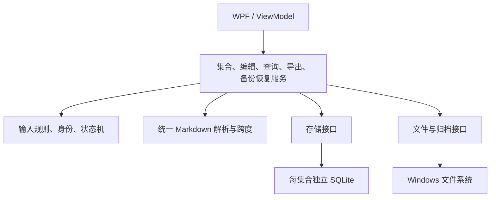
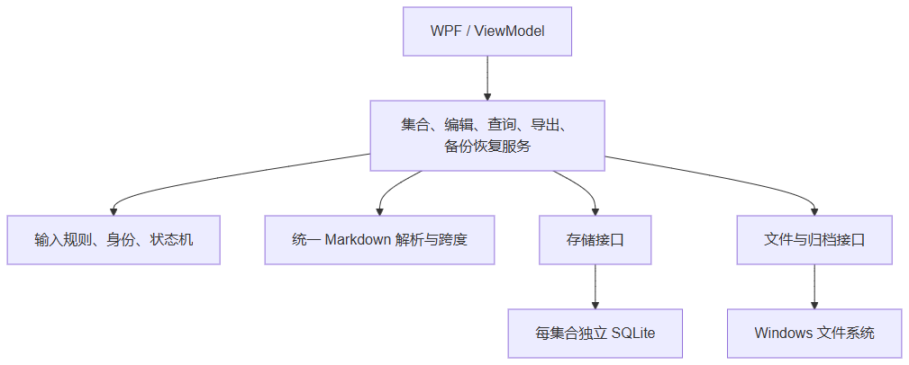
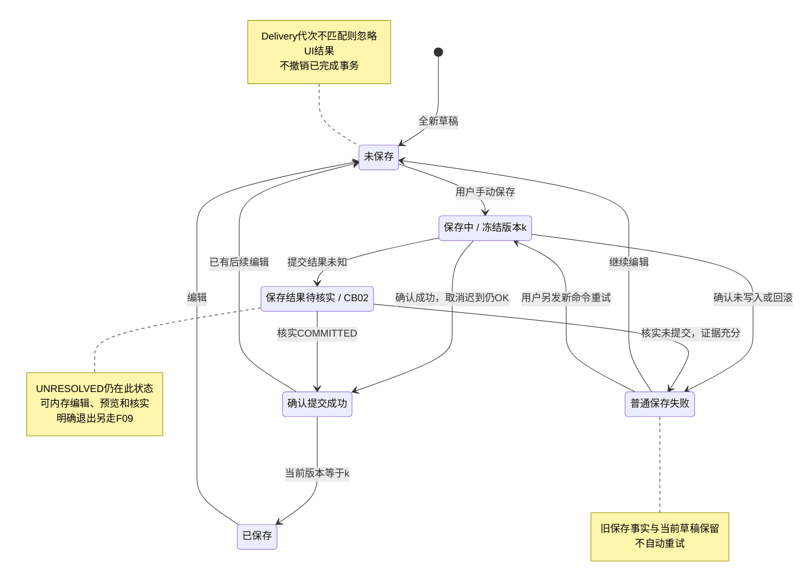
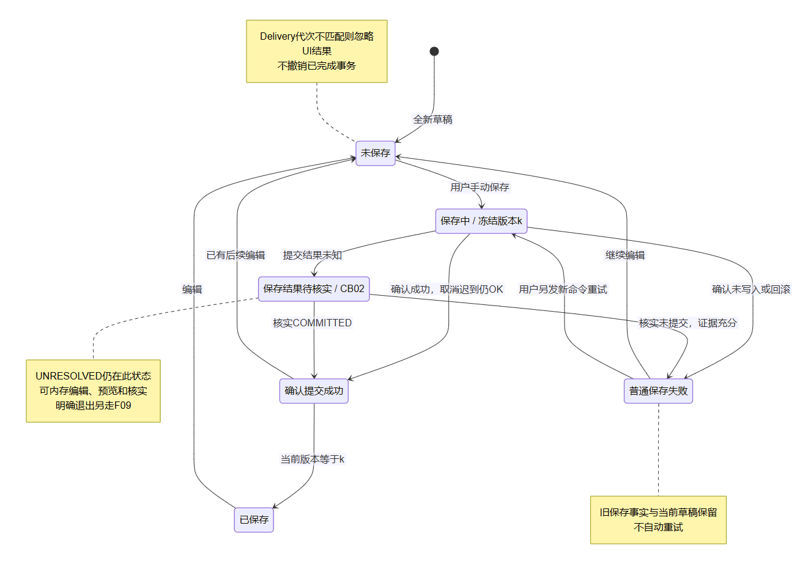
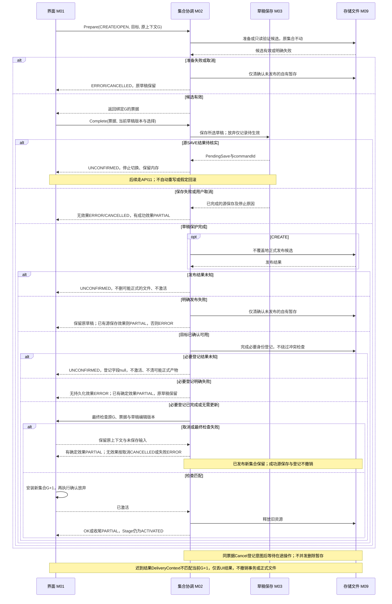
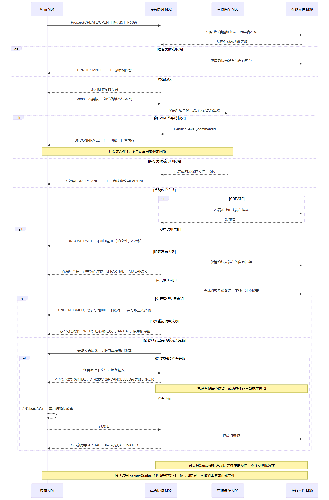

> 历史参考：这是切换Python之前确认的C#设计第二版。2026-10-18起当前开发设计见[Python设计](../design.md)。本文件的技术选择及C#签名不作为当前实现契约；业务不变量和历史SQL样例按当前说明使用。

# 个人 Markdown 笔记与知识管理工具：软件设计文档

- 实验：软件设计文档生成（架构设计与系统设计）。
- 版本：实验二第二版定稿，供第二次提交使用；依据首次评分反馈及定向核查修订。
- 整理日期：2026-10-14（材料整理日期，不作为软件测试或个人核查时刻）。
- 状态：用户本轮核对定向核查材料，并明确同意类型契约与结果表示、Unicode输入解释、离线发行及必要身份登记策略三项选择；作为本轮设计审查决定记录于SD14，不倒写为第一关需求，也不表示软件验证完成。
- 实施状态：系统尚未开发。功能、性能、离线、故障、隐私及兼容性验收均未执行。
- 验证区分：本文的产品验证为计划；附录中的独立 SQLite 小样例只核对部分设计语句和关系约束，不是软件实现或功能验收。

## 第二次提交修订摘要

针对首次评分97.2/100的意见，补API01／02／08／11类型契约、F01时序及保存状态图、F09操作表、VAL01—08清单与伪代码、部署说明、使用侧重点及18条需求摘要／约束索引。定向核查统一已完成操作OK、确定部分完成PARTIAL、未知UNCONFIRMED，补可空配置登记结果、退出最终版本检查，并将身份断言限定为LIVE。上述已纳入本轮设计审查决定，技术方案仍是设计选择；系统尚未开发。

阅读路径：架构与部署SD02；数据和校验SD04；接口精确契约5.3；F01与保存图SD07／6.5；追踪SD12；未执行的产品验证计划SD13；需求来源、CB01／CB02与本轮决定SD14。第一关v3未合入，本稿继续依据第一关第二版。

<a id="SD01"></a>

## SD01　依据、范围与统一状态

### 1.1 需求来源与范围

需求依据是实验二第一次提交所用的[第一关第二版正式需求文档](https://github.com/clairvoyanttt/personal-markdown-knowledge-base/blob/3e4a84a480f04c656c159c99719bc7c58e9b7985/docs/requirements.md)，用公开历史链接定位该文档版本；[仓库文档入口](https://github.com/clairvoyanttt/personal-markdown-knowledge-base/blob/main/docs/requirements.md)保留作项目入口，不能用它以后发生的变动悄悄替换本轮依据。导出、备份和集合规则与第二版FR09／11／16对齐，编号／优先级保持。第一关v3提交包尚未同步，精确UI字典、固定UTC毫秒及恢复时刻等不纳入本设计。

首版为 Windows 11 上面向学生与知识工作者的个人、本地、离线工具，围绕“记录—组织—查找—关联—输出”使用。学生课程笔记、复习整理和知识工作者专题积累是设计场景，不代表开展过用户访谈。

| 类型 | 编号与范围 |
|---|---|
| 首版功能 | FR01—FR11、FR16，共 12 条 |
| 首版非功能 | NFR01—NFR06，共 6 条 |
| 范围外编号 | FR12 同步、FR13 插件／主题、FR14 移动端、FR15 协作 |

共 18 条首版需求，15 条高优先级、3 条中优先级；中优先级的 FR03、NFR03、NFR04 仍需验收。不增加自动保存、回收站、历史版本、崩溃草稿恢复、集合删除／合并／并行打开、跨集合引用、AI、OCR、PDF／HTML 或附件打包。

### 1.2 状态定义

| 术语 | 含义 |
|---|---|
| 集合／活动集合 | 有独立标识和本地位置的数据单元；一次只有一个活动集合 |
| 候选集合 | 创建或验证中的目标，尚不承接活动编辑 |
| 草稿 | 本会话内存中的名称、正文、标签及引用修改；不承诺退出后恢复 |
| 已保存版本 | 最近一次已确认持久化成功的内容 |
| revision／collectionRevision | 笔记版本／集合变更版本；保存、删除等成功事务推进相应版本 |
| commandId | 一次持久化命令的唯一标识，用于核实该命令 |
| operationId | 操作批次标识；普通保存与 commandId 相同，恢复时关联集合及各笔记初始化回执 |
| contextGeneration | 活动上下文代次，用于丢弃旧集合的迟到结果 |
| 发布／激活 | 正式有效文件成为可打开集合／应用安装其活动上下文；二者完成点不同 |

### 1.3 内容版本规则

编辑和预览使用当前草稿；笔记列表名称、标签筛选、标题／正文搜索、目标名称、其他笔记反向引用、导出和备份使用已保存版本。正文、名称、标签和引用的修改均需手动保存。预览等读取操作不得隐式保存。

CB02 待核实期间，内存编辑保留；旧列表和关系标注“最后已确认状态”，不得冒充刚从数据库确认的当前结果。

<a id="SD02"></a>

## SD02　架构、部署与运行视图

### 2.1 技术选择

C#／.NET 10／WPF、MVVM 和每集合独立 SQLite 是本实验经用户接受的设计选择，不是第一关规定的技术实现。拟用 AvalonEdit 编辑适配层、Markdig 解析适配层及 Microsoft.Data.Sqlite 存储适配层；具体依赖版本和许可证在实现时记录，不声称已安装或完成兼容验证。

| 选择 | 理由与代价 |
|---|---|
| WPF／MVVM | 适合 Windows 桌面交互和可观察状态；首版不支持跨平台界面 |
| 独立 SQLite | 正文、标签、身份与引用在一个事务中更新；需导出 Markdown，不能将数据库当普通笔记文件编辑 |
| 统一语法树及原文跨度 | 保存、预览、导出、恢复一致；需要验证跨度和保护范围 |
| WPF 预览 | 不执行 HTML 脚本、不自动加载远程资源；原始 HTML 不作为首版渲染承诺 |
| 离线部署包 | 拟包含运行依赖；安装及核心运行无需在线账号或服务 |



### 架构图兼容显示

以下为同一Mermaid架构图的已渲染图片，供不支持Mermaid的阅读器查看。图片只是设计视图，不是软件运行截图；上方源码与下方文字依赖链均保留。



即使阅读器不渲染图，也可按这条依赖链理解：WPF界面／视图模型调用应用服务；应用服务依赖领域规则、统一Markdown解析、存储接口和文件接口；存储接口由SQLite适配层实现，文件接口由Windows文件／归档适配层实现。解析边界对应M04，数据库和文件适配对应M09。接口表达业务输入、版本和结果，不把WPF控件或SQL连接传入领域规则。

领域规则不依赖 WPF 或 SQL。基础设施实现接口，界面不直接执行数据库操作。

### 2.2 运行及部署

| 执行部分 | 职责与约束 |
|---|---|
| UI 线程 | 输入、对话框、状态显示、受控活动上下文切换 |
| 每集合串行存储队列 | 写事务、一致快照、提交核实；不交错执行本应用写入 |
| 解析／查询任务 | 携带编辑版本、查询编号及上下文代次；结果过期即丢弃 |
| 文件任务 | 使用冻结快照生成导出、备份、恢复候选文件 |
| 集合协调器 | 统一未保存保护、发布、激活和资源所有权 |

候选集合可短暂拥有验证连接，不提供第二个活动编辑环境。拟采用应用单实例控制。正式集合文件为 knowledge.sqlite；本地应用配置只记录必要位置、身份和诊断信息，不记录正文。导出为 .md；备份拟为 .pmkb ZIP 容器。不存在后端服务器、账号和云数据库。

<a id="DEPLOYMENT"></a>
### 2.3 发行包及本地位置关系（本轮已确认设计）

拟采用与目标Windows11 CPU架构对应的自包含离线文件夹发行包，外层ZIP命名为`PersonalMarkdownKnowledgeBase-<应用版本>-win-<架构>.zip`。解压到用户选择的可读可执行程序目录AppHome，包含EXE、.NET桌面运行依赖、已选组件及许可证；不要求在线账号或启动时联网下载。CPU架构和组件实际版本在实现／真实测试时记录，不能凭本稿声称已产出发行包或支持所有架构。[Microsoft自包含部署说明](https://learn.microsoft.com/en-us/dotnet/core/deploying/)支持这种部署方式；实际依赖和Windows基础组件仍须V11／V12验证。

| 位置 | 拟存内容／关系 | 数据保护与验证 |
|---|---|---|
| `<AppHome>` | 程序与依赖；是程序位置，不是默认笔记集合 | 更换程序目录不改集合数据库，不能将安装包中的空数据库覆盖用户数据；V12 |
| `<用户选择的集合目录>\knowledge.sqlite` | 单集合正文、身份、标签、引用出现项、回执和元数据 | 每个集合独立文件；CREATE空目标／OPEN有效目标；不把配置文件当笔记保存事实；V09／V15 |
| `%LOCALAPPDATA%\PersonalMarkdownKnowledgeBase\config.json` | 每Windows用户本地配置：必要位置、已知集合身份登记及有限诊断设置；不含正文或草稿 | 不增加最近列表、账号或启动自动打开；配置不可读时说明原因，可由用户重新选择集合，不覆盖旧配置／数据库；V11／V12／V15 |
| 导出／备份目标 | 用户明确选择的`.md`／`.pmkb`文件位置 | 与AppHome／配置／集合目录分别管理，既有文件不覆盖；V07／V08 |

这些是位置设计，示意路径不是用户真实设备或测试记录；不创建用户不可见的云目录。M02身份核对与M09原子配置写入要保持一致；必要登记在目标有效／CREATE发布后、最终激活前完成。配置不可读或必要登记明确失败时不激活、不绕过登记；原集合／草稿保留，可重选但须配置可读才激活。已有新产物／源保存／登记成功效果报告PARTIAL，确认无这些效果才ERROR；登记结果未知报告UNCONFIRMED，ConfigurationUpdated=null，不删可能正式的配置或集合。非必要诊断写入失败只警告，不据此删除或回滚集合。该策略属于本轮已确认设计选择，V15拟检查、未执行。

**不支持schemaVersion时的路径：** OPEN先以只读方式读取模式／版本，应用当前设计仅支持schemaVersion=1；未知／更高／不可识别版本返回SCHEMA_UNSUPPORTED，不尝试写表、建立新库或自动迁移。设计提示为“该集合的数据格式版本不受支持，已停止打开；原集合和当前编辑内容保持不变。”并给出检测版本／支持范围及重选位置或使用兼容版本的动作。恢复也在产生可发布产物前检查manifest与snapshot的版本。不支持时不动原目标、原备份或活动集合，仅读取连接释放；其自有未发布暂存才可清理。提示字面属于本实验设计，不是第一关v3规范。

V12／V14／V16使用独立“未来模式”受控样例验证拒绝和数据不变；不能在A.1的`CHECK(schemaVersion=1)`数据库中硬改为2并把约束失败当作应用拒绝不支持模式。应用文件升级和数据模式升级是两件事，本稿不提供自动迁移、修复或格式降级功能。


<a id="SD03"></a>

## SD03　模块职责与依赖

| 模块 | 职责 | 依赖／限制 |
|---|---|---|
| M01 界面与视图模型 | 入口、状态、确认和反馈 | 应用服务；不直接写库 |
| M02 集合协调 | 创建、打开、切换、发布和激活 | M03、M09；统一草稿保护 |
| M03 编辑与持久化 | 草稿、保存、删除、回执核实 | M04、M09 |
| M04 解析与引用 | 语法树、保护跨度、出现项及分类 | 无独立持久化副作用 |
| M05 已保存查询 | 筛选、搜索、反向引用 | M09；不能用草稿替代保存事实 |
| M06 预览 | 当前编辑效果 | M04；目标状态取已确认数据 |
| M07 导出 | 单篇保存版本的文本转换 | M04、M09 |
| M08 备份恢复 | 快照、清单、转换、初始化 | M04、M09 |
| M09 基础设施 | SQLite、事务、文件、归档 | 集中连接配置和错误转换 |

<a id="SD04"></a>

## SD04　数据模型、约束与一致性

### 4.1 主要实体

集合、笔记、提交及批次标识均为 32 位小写十六进制文本。身份使用至少 128 位随机性或等效方式产生并检测已知冲突，不从名称、位置或序号推导。删除或缺失保留身份不复用。

| 实体 | 主要字段 | 语义与约束 |
|---|---|---|
| CollectionMeta | singletonId、collectionId、schemaVersion、collectionRevision、state | 单行；正式集合须 READY；恢复后新集合版本初始化为 1 |
| NoteKeys | noteId、state、liveNoteId、lastSavedName | LIVE／DELETED／MISSING_RESERVED 身份账本；已删除名称保留 |
| Notes | noteId、keyState、name、nameKey、body、revision、lastCommitId | 当前保存内容；必须对应 LIVE；lastCommitId 指向产生该笔记版本的笔记级回执 |
| NoteTags | noteId、tag | 同笔记同标签唯一；BINARY 区分大小写 |
| RefOccurrence | sourceNoteId、sourceRevision、ordinal、targetCollectionId、targetNoteId、startUtf16、lengthUtf16、displayHint | 保存正文的派生出现项；不存另一份权威目标分类；提示不作为身份依据 |
| CommitReceipt | commandId、operationId、collectionId、operationKind、noteId、beforeRevision、afterRevision、collectionRevision | 事务证据，无历史正文；具体类型见下表 |

| 回执类型 | noteId／修订字段 | lastCommitId 与 API11 的关系 |
|---|---|---|
| SAVE | noteId 必填；新笔记 beforeRevision 为空，否则为旧版本；afterRevision 为新版本 | 成功保存的 Notes 指向它；API11 可核实匹配的本集合待核实 SAVE |
| DELETE | noteId 必填；beforeRevision 为删除前版本；afterRevision 为空 | 无存活 Notes 指向它；保存核实不接受该类型 |
| RESTORE_INIT | noteId、前后笔记修订均为空；operationId 等于 commandId | 集合级初始化证据；任何 Notes 都不指向它 |
| RESTORE_NOTE_INIT | noteId 为对应恢复笔记；beforeRevision 为空；afterRevision 等于保留的笔记 revision | 每篇恢复笔记有不同 commandId，lastCommitId 指向自身回执；API11 不把它当 SAVE |

恢复的集合级回执和逐篇回执共享同一个新 operationId、归属新集合、collectionRevision 为 1。零篇笔记的恢复只有集合级回执。普通 SAVE／DELETE 的 operationId 等于各自 commandId。首版不自动清理回执，以保留核实证据覆盖；这不提供版本历史功能。

### 4.2 内存模型

DraftBuffer 保存 bufferId、可空 noteId／baseRevision、名称／正文／标签、editVersion 和修改状态。全新草稿没有已保存版本。PendingSave 保存命令标识、拟用身份、冻结草稿和原保存状态。SavedSnapshot 保存一次一致读取的集合版本；ParsedDocument 保存语法树及跨度；ActivationTicket 保存原代次、目标、发布状态和暂存资源。

### 4.3 数据库与应用的职责分工

| 规则 | 数据库保证 | 应用／事务检查 |
|---|---|---|
| Notes 与 LIVE 身份双向存在 | 双向延迟外键、CHECK、NOT NULL | 打开和恢复检查模式及历史数据 |
| 源出现项属于正确修订 | Notes(noteId, revision) UNIQUE 与复合外键 | 原文标记、跨度、顺序和解析结果一致 |
| 删除源后不留标签／出站项 | ON DELETE CASCADE | 确认身份、修订号和用户选择 |
| 名称唯一／标签不重复 | nameKey UNIQUE／复合标签主键 | 先拒绝基线控制字符，再裁剪；码点长度、20项上限；nameKey 仅折叠英文 A—Z，不做额外正规化 |
| 身份不修改、不删除、不复用 | 触发器；只允许 LIVE→DELETED 或原状态 | 生成时排除已知身份；缺失身份保留 |
| 目标删除、缺失、第三集合可存 | 不对引用目标设置必须指向存活 Notes 的外键 | 先判集合归属，后判目标状态；不得按名称回退 |
| 回执与笔记版本一致 | 标识唯一及回执字段形状 CHECK | lastCommitId 的回执须匹配集合、笔记、操作类型和 afterRevision；SAVE 内容与提交快照一致 |
| 递增、并发和索引语义 | 修订正数、关系约束 | 预期旧版本匹配；标签数量、跨度范围、不重叠及派生数据完整 |

lastCommitId 不靠“某个回执存在”就证明业务正确：本设计不设置这一简单存在性外键，采用上述语义检查；恢复初始化和每次保存均须执行。核心 DDL 见[附录 A](#appendix-a)。

名称去空白后 1—100 个 Unicode 码点，标签 1—30 个，每篇最多 20 个不同标签；先拒绝 U+0000—U+001F、U+007F，再裁剪允许的首尾空白。名称英文判重不分大小写并排除自身；标签区分大小写。UTF-16 偏移不能充当码点长度。1000篇／10KB 不是容量上限。

### 4.4 连接与更新顺序

每个连接在事务前执行 PRAGMA foreign_keys=ON 并读取确认值为 1；包括查询、候选、快照验证和恢复连接。父键组合须完整匹配唯一约束；双向外键为 DEFERRABLE INITIALLY DEFERRED、NO ACTION，不用立即处理的 RESTRICT。[SQLite 官方规则](https://www.sqlite.org/foreignkeys.html)。

首次保存在一个事务插入 LIVE 身份、Notes、标签、出现项、缺失身份、SAVE 回执并推进集合版本。再次保存检查 baseRevision，删除旧出站项、更新正文和修订、替换标签／新出现项，同步账本名称并写回执。

删除先将身份改为 DELETED、清空 liveNoteId、保留名称，再删除 Notes；标签和出站项级联删除，其他笔记的入站项保留。删除及回执、集合版本处于同一事务。

延迟约束提交失败不等于事务自动结束，须显式回滚。只有确认未写入或已回滚才报告普通失败；不能确认时进入 CB02。

### 4.5 快照与权威事实

snapshot.sqlite 中的保存正文、Notes、NoteKeys、标签、集合元数据是权威业务事实；RefOccurrence 是需重解析核对的派生索引。引用状态由快照集合标识和身份数据计算，不由 manifest 覆盖。

### 4.6 manifest.json 字段与核对

| 字段 | 类型／来源 | 恢复核对与用途 |
|---|---|---|
| formatVersion、schemaVersion | 受支持的整数版本 | 不支持则拒绝 |
| snapshotEntry | 固定字符串 snapshot.sqlite | 必须有且不重复；禁止目录穿越 |
| sourceCollectionId | 快照 CollectionMeta 的集合标识 | 与快照一致；供归属转换 |
| sourceLocation | 捕获时活动集合完整本地目录，非空字符串 | 给用户识别；核对字段格式，不要求目录存在，不访问该路径 |
| backupCapturedAtUtc | 捕获服务在实际冻结快照时读取系统时钟生成的 UTC 时间，ISO 8601 带 Z | 必须可解析；显示时明确时区；不是预填时间、需求批准时间或事后猜测时间 |
| sourceCollectionRevision | 快照集合修订号 | 与快照一致 |
| savedNoteCount | 快照 Notes 行数，非负整数 | 重新计数一致，不包含草稿或已删除身份 |
| referenceCounts | valid／deleted／missing／foreign 四个非负计数 | 按快照重解析分类逐出现次数核对，不是去重目标数 |

来源位置与捕获时间的识别信息以清单为记录来源，由捕获服务从活动上下文和实际时钟写入；它们不能从笔记正文反推。恢复只核对存在、格式和可读性，不声称证明原设备时钟准确或该历史路径真实可达。集合标识、版本、数量和分类则以 snapshot.sqlite 为准，清单仅核对。清单不另存逐引用分类。

同一捕获操作绑定 sourceLocation、sourceCollectionId 和快照，防止切换后混入另一集合。backupCapturedAtUtc 定义为成功备份所含快照的实际捕获时间，不称为最终文件发布完成时间。失败不报告有效备份；不提供签名或来源真实性认证承诺。

### 4.7 恢复初始化一致性

恢复先在暂存副本分类并转换，再在一个事务内：更换集合标识、设 collectionRevision=1、删除全部复制来的旧回执、生成新的 RESTORE_INIT、为每篇 Notes 生成不同的 RESTORE_NOTE_INIT，并设置对应 lastCommitId。各笔记 revision 保留；前版本为空表示初始化，不能解释成此前在新集合保存过。

提交前检查：每篇 lastCommitId 都匹配新集合、该 noteId、RESTORE_NOTE_INIT 和 afterRevision；没有笔记指向集合级回执；没有旧回执残留；正文／标签／出现项及身份约束一致。后续手动保存产生新 SAVE 并推进该笔记 revision，lastCommitId 才更新到 SAVE。

API11 必须使用“当前集合＋待核实 commandId＋SAVE 类型＋笔记＋前后版本＋提交内容”核实；旧集合回执、集合级初始化、逐篇初始化均不能证明新的 SAVE。原集合和备份文件不修改。

<a id="VALIDATION"></a>
### 4.8 应用校验清单与事务断言（设计伪代码，产品验证未执行）

本节将原业务结果写成实现可遵循的顺序；不是实际实现，不以独立SQL样例证明本节成立。名称／标签长度按Unicode码点，引用跨度按UTF-16单元，两者不能共用`string.Length`判定。

| 校验项 | 应用检查／处理 | 数据库能保证什么 | 拟验证样例及预期 |
|---|---|---|---|
| VAL01 名称形状 | 原始输入先拒绝C0／DEL；检查单行；再裁剪首尾空白、严格计码点，1—100；不做Unicode正规化 | Notes.name非空值但DDL不检查码点长度；需应用实现 | V01／V14：100个补充平面字符可继续保存，101个拒绝；首尾制表符拒绝，不能先Trim；中文空格样例不变 |
| VAL02 名称键 | 仅将A—Z折叠为a—z，查询已保存nameKey时排除当前noteId，提交事务中再次核对 | nameKey UNIQUE在最后提交阻止结构性重名，但不能证明折叠函数正确 | V01／V14：自身Note→note可成功；另一篇→note／NOTE拒绝；两事务冲突之一失败，原引用不变 |
| VAL03 标签 | 每项先拒控制／多行、Trim、1—30码点；按Ordinal区分大小写去重判断；不得将重复项存两次；最多20个不同项 | NoteTags主键及BINARY阻止重复保存；不保证30码点或20项 | V01／V04／V14：30／31码点、20／21项；AI与ai各计1；满20项再添加已有标签仍无新项 |
| VAL04 版本与代次 | Buffer所属集合、editVersion、baseRevision及票据绑定匹配；最终激活前再核对；迟到UI结果校验DeliveryContext | 修订正数、源外键可以限制表形状；不能保证UI上下文或草稿捕获版本 | V02／V03／V13／V15：保存期间再编辑；旧G结果不显示；新G激活后旧票据拒绝 |
| VAL05 解析与原文跨度 | 先建立保护跨度，再识别74单元完整标记；统一半开区间；边界不切代理对、不超长、不重叠、原文切片吻合 | start≥0、length=74、源版本复合外键／起点唯一；不保证跨度确指向正文标记 | V05／V07／V09／V14：`😀 `前缀使标记起点UTF-16=3；代码、网页链接／图片保护；越界／重叠索引拒绝 |
| VAL06 引用归属 | 先比较集合，再查本地NoteKeys；foreign不建本地缺失身份；LIVE核正文；DELETED／missing保原因；不按名称回退 | 无“目标必须存活”的外键，正常失效可保存；身份触发器禁止复用 | V05／V06／V09／V14：不同集合相同noteId仍foreign；同名重建不复活；恢复四类与代码逐项保持 |
| VAL07 原子保存／删除 | 准备全部规范化字段和出现项；同事务更新身份、正文、标签、引用、回执及版本；明确回滚与未知分开 | 双向延迟外键、源修订FK、级联、唯一键与CHECK | V02／V06／V14：删除源无出站、删除目标保入站；旧sourceRevision拒绝；少身份或正文拒绝 |
| VAL08 回执核实 | SAVE核实必须匹配集合、命令、笔记、前后版本、lastCommitId及提交快照；原事务结束证据另查 | 回执字段形状与ID唯一；不验证整个提交语义 | V13／V14／V16：初始化／旧集合回执不能证明SAVE；没有回执但事务不明仍UNRESOLVED |

单行输入沿用第一关第二版要求；采用.NET空白语义在拒绝原始C0／DEL之后裁剪，将U+2028／U+2029作为行分隔符拒绝，无配对代理项保留输入并拒绝保存／解析，不默默替换。这三项是用户本轮接受的实现解释，不是第一关已经列明的规则；不增加正规化、容量或跨集合能力。

以下伪代码把失败路径写在入口，实际实现可用`Rune.DecodeFromUtf16`逐码点解码并检查状态，不能使用遇到无效序列自动替换的计数方式。[Microsoft Rune文档](https://learn.microsoft.com/en-us/dotnet/api/system.text.rune.decodefromutf16?view=net-10.0)只支持解码接口，不能证明本产品校验已实现。

```text
ValidateText(raw, maxCodePoints, errorCode):
    require raw != null
    if any U+0000..U+001F or U+007F in raw: reject(errorCode)
    if contains U+2028 or U+2029: reject(errorCode)   # 本轮已确认的单行设计细化
    value = TrimAllowedWhitespace(raw)
    count = 0; i = 0
    while i < Utf16Length(value):
        (status, scalar, consumedUnits) = DecodeOneScalar(value, i)
        if status != Done: reject(errorCode)         # 不替换非法代理项
        count += 1; i += consumedUnits               # consumedUnits为1或2
    if count < 1 or count > maxCodePoints: reject(errorCode)
    return value

ValidateName(raw, currentNoteId, savedSnapshot):
    value = ValidateText(raw, 100, INVALID_NAME)
    key = FoldAsciiAZOnly(value)                      # 不改其它字符
    if saved nameKey == key and noteId != currentNoteId: reject(DUPLICATE_NAME)
    return (value, key)                              # 事务中再查并依赖UNIQUE

ValidateCompleteTags(items):
    require items != null and no null item
    accepted = empty OrdinalSet
    for raw in items:
        tag = ValidateText(raw, 30, INVALID_TAG)
        if tag already in accepted: reject(INVALID_TAG, duplicate tag)
        else if accepted.Count == 20: reject(TAG_LIMIT)
        else add tag
    return accepted                                 # 输入框原字面另行保留
```

普通“添加重复标签”反馈该项已存在，并保留原标签列表；保存／整版编辑接口接收已接受的不同标签列表。如直接提交重复完整列表，上面伪代码拒绝INVALID_TAG，不静默改写提交快照。重复判定先于20项上限，因此满20项时重复已有标签仍不能误报为新增第21项。任何拒绝均保留原草稿和输入，不更新已保存筛选。

```text
ParseOccurrences(body, parserAdapter):
    assert body is valid UTF-16                      # 本轮已确认设计细化；不替换非法代理项保存
    tree = parserAdapter.Parse(body)
    protected = NormalizeToUtf16HalfOpenIntervals(
        code, complete external links including title/destination,
        images/attachment links, escaped openings)
    refs = []
    for complete [[note:<32 lowerhex>:<32 lowerhex>]] in unprotected text:
        span = [startUtf16, endExclusiveUtf16)
        assert 0 <= start < endExclusive <= Utf16Length(body)
        assert endExclusive - start == 74
        assert neither boundary splits a surrogate pair
        assert no intersection with protected or already accepted spans
        assert Slice(body, span) == original complete marker
        append occurrence with parsed IDs and ordered ordinal
    return refs                                     # 不识别短K1或坏格式

Classify(ref, savedSnapshot):
    if ref.collectionId != savedSnapshot.collectionId: return FOREIGN_COLLECTION
    key = lookup exact ref.noteId in NoteKeys
    if key absent or MISSING_RESERVED: return MISSING
    if key DELETED: return DELETED
    if key LIVE and matching Notes exists: return VALID(saved name)
    reject inconsistent saved data                 # 不能猜同名替代

ConvertSelectedSpans(body, refs, operation):
    replacements = derive only permitted export text or restore CID conversion
    apply replacements from greatest startUtf16 to smallest
    assert all untouched raw slices identical to input
```

库跨度若采用闭区间或不同索引单位，M04适配层必须转换；不能把库的End直接当endExclusive。保护跨度是由同一解析树确定，不仅做全正文正则替换。恢复先按原快照Classify，再只转换来源集合非代码标记的归属，原本deleted／missing保持原因；第三集合不转换。导出使用SD06.4原前缀及限制，外部链接、代码和图片路径不改。

```text
PersistValidatedSave(snapshot, expectedBaseRevision, commandId):
    validate fields, context and frozen editVersion; build canonical name/tags/refs
    open configured connection; verify foreign_keys == 1
    BEGIN transaction
    verify expected source revision and command uniqueness again
    if existing note: remove old outgoing occurrences
    create or update LIVE identity and Notes; reserve local missing IDs as needed
    replace owned tags; insert outgoing occurrences for the new sourceRevision
    write same-transaction SAVE receipt; advance collection revision
    assert every Notes has matching LIVE identity
    assert every LIVE identity has corresponding Notes # DELETED/MISSING_RESERVED无正文正常
    assert refs' sourceRevision and raw spans agree with that body
    assert lastCommitId matches this collection/note/SAVE/new revision
    COMMIT
    if confirmed success: report captured version only
    else if confirmed not written or rolled back: preserve draft and old facts
    else: preserve PendingSave and enter CB02; do not resend the write
```

“assert”表示应用事务检查，不是声称DDL已有该语义断言。触发器及延迟约束见4.3／附录；COMMIT失败须显式结束／回滚且确认结果，不能把抛异常自动等同回滚。DDL中的Notes.name/body仅为NOT NULL，长度、Unicode和正文解析须由本清单及适配契约验证；20标签也不是SQLite CHECK的现成保证。


<a id="SD05"></a>

## SD05　内部、外部接口与错误约定

### 5.1 共同约定

调用携带集合标识、contextGeneration及必要的预期版本。OK表示本次接口目标完成，ERROR表示明确失败，CANCELLED表示本次无新增正式产物、成功源保存或必要配置更新的取消，PARTIAL表示已有确定效果但多阶段目标／收尾未完成，UNCONFIRMED表示仍有结果未知；前次未决SAVE不因本次核实取消而回滚。错误含业务码、可读原因和后续动作；日志不包含正文。

| 编号／接口 | 输入 | 输出 | 错误／调用限制 |
|---|---|---|---|
| API01 Prepare／Complete／CancelActivation | CREATE／OPEN、目标位置、原代次、逐草稿选择及编辑版本 | 发布状态、激活状态、集合标识、正式位置 | 统一未保存保护；已发布未激活为 PARTIAL；只清理未发布自有资源；旧票据拒绝 |
| API02 CreateDraft／Load／ApplyEdit／SaveNote | 名称、身份、整版草稿编辑字段；保存含命令、冻结快照、baseRevision | 草稿、保存修订或待核实状态 | 非法、重名、版本冲突；普通失败保留输入；不明确进入 CB02 |
| API03 DeleteNote／CheckDelete | 身份、预期修订、删除及未保存内容确认；核实含原DELETE命令 | 删除结果、新集合版本或未核实状态 | 无确认不删；未知结果核对本集合DELETE回执、对应删除前版本及DELETED／无正文状态，不调用SAVE核实分支 |
| API04 QuerySaved | 查询编号、关键词／标签、上下文 | 完整结果、数量、集合版本 | 仅保存版本；空查询清旧结果并提示；迟到结果丢弃 |
| API05 Build／ResolveReference、ListBacklinks | 已保存目标、合法插入偏移；标记及保存视图 | 完整标记、名称／原因、去重源笔记列表 | 插入只改草稿；不按名称或局部标识回退；反向引用仅保存项 |
| API06 BuildPreview | 当前正文、编辑版本、已确认目标视图 | 版本化预览 | 不写库；不执行脚本；旧结果丢弃 |
| API07 ExportNote | 当前选择、目标文件、未保存处理选择 | 路径、所用修订 | NO_SAVED_VERSION；先提示，保留 FR09 文本；已有文件拒绝；待核实阻止 |
| API08 BackupCollection | 目标文件、未保存选择、上下文 | 备份路径、来源标识／位置、实际捕获时间、保存数量及版本 | 草稿排除并提示；冻结快照生成清单；不覆盖；待核实阻止 |
| API09 RestoreBackup | 备份、空目标 | 新集合、位置、数量及来源识别信息，不激活 | 校验清单／快照；初始化逐篇回执；不访问来源位置；异常不改原数据 |
| API10 CommitMutation／ReadSavedSnapshot | 校验后的变更、预期版本；读取请求 | 事务结果或一致快照 | 仅应用服务调用；统一连接设置、参数化 SQL 和证据检查 |
| API11 CheckCommit／CloseUnconfirmedSession | PendingSave、原保存状态；明确退出风险确认 | COMMITTED／NOT_COMMITTED／UNRESOLVED，或带未知提示的关闭 | 仅接受本集合匹配 SAVE；找不到回执不直接等于失败；不自动重写、不承诺草稿恢复 |

错误码包括 INVALID_NAME、DUPLICATE_NAME、INVALID_TAG、TAG_LIMIT、REVISION_CONFLICT、NO_SAVED_VERSION、TARGET_EXISTS、TARGET_NOT_EMPTY、INVALID_BACKUP、SCHEMA_UNSUPPORTED、STALE_CONTEXT、COMMIT_UNCONFIRMED。DELETED／MISSING／FOREIGN_COLLECTION 是正常引用分类，不统一报为数据库损坏。

### 5.2 外部接口

Windows 文件接口接收用户选定的合法位置，返回实际路径或具体错误；已有导出／备份不覆盖。SQLite 仅经 M09 的参数化事务调用。解析器接收原文并返回树及跨度，不联网。ZIP 只接受规定关键条目，拒绝重复、缺失、目录穿越或不支持格式。

外部链接仅在用户明确操作后交给系统关联程序。图片和附件路径作为原文保留，不下载、不打包、不保证迁移后可用。应用配置中的身份登记用于冲突检测，不增加最近使用列表需求。

<a id="API-CONTRACTS"></a>
### 5.3 四组接口的类型契约（本轮已确认设计，未编译或运行）

下列C#风格签名和`record`只描述设计接口，无方法体，不是已经实现的源码。M01调用应用服务，M02协调集合，M03拥有草稿／保存及核实，M08拥有备份；M09提供事务／文件能力。调用不含角色、账号或网络端点。`string`不可空，`string?`可空；集合型字段不可空、可为空集合。服务捕获输入时深拷贝列表及正文，`IReadOnlyList`本身不保证调用者不会修改原集合。

#### 5.3.1 公共字段与结果约定

```csharp
public enum ResultStatus { OK, ERROR, CANCELLED, PARTIAL, UNCONFIRMED }
public record CallContext(string? CollectionId, long ContextGeneration);
public record AppError(string Code, string Reason, string SuggestedAction);
public record OperationResult<T>(
    ResultStatus Status, CallContext RequestContext, CallContext DeliveryContext,
    T? Value, AppError? Error, IReadOnlyList<AppError> Warnings) where T : class;
```

| 字段／类型 | 取值及可空约束 | 使用规则 |
|---|---|---|
| 各集合／笔记／命令／票据／草稿标识：`string` | 32位小写十六进制；由服务分配的票据、草稿、待核实标识也是不透明标识；不从名称推导 | 各ID按其类别校验，不将票据ID当笔记ID；已保存身份不可复用 |
| `CallContext.CollectionId`：`string?` | 仅无活动集合时为空；非空须满足ID格式并匹配活动集合 | API01可从无集合状态调用；API02／08／11要求活动集合 |
| `ContextGeneration`：`long` | 会话内初始0，激活成功递增；非负，不回绕 | API01最终激活前再次比较原代次；其他调用和UI读取结果按该代次保护 |
| `revision`／`collectionRevision`：`long` | 已保存值≥1；递增前检查不溢出；新草稿`baseRevision`为空 | `baseRevision`与数据库当前值匹配才写；类型范围不是产品容量上限 |
| `editVersion`：`long` | 草稿初值0，每次编辑递增；非负，不回绕 | 保存冻结版本k，成功只确认k；随后编辑不能被标为已保存 |
| 枚举、请求对象及嵌套对象 | 枚举只接受列出的成员；request、Context及必填Snapshot等不可空 | 拒绝未定义枚举值或空对象，返回INVALID_ARGUMENT；不能把空值猜作默认操作 |
| `Reason`／`SuggestedAction`：`string` | 非空可读原因／后续动作，不暴露SQL堆栈或正文 | 沿用现有业务码；不把引用分类当数据库损坏 |
| `Value`：`T?`，`Error`：`AppError?` | OK必有Value、Error为空；ERROR必有Error；UNCONFIRMED必有Value和Error；CANCELLED可带取消诊断但不能填保存／激活成功字段；PARTIAL必有Value，Error说明未完成部分／收尾问题 | 失败不从可空Value猜成功；Warnings可为空列表，不能替代结果状态；ERROR的Value若非空仅带诊断，不填本次保存／激活成功字段 |
| `RequestContext`／`DeliveryContext` | 均不可空；普通调用两者相同；API01真正激活后Delivery为新集合及新代次 | M02在UI线程安装上下文前核对Request；安装后才构造新Delivery。旧异步结果的Delivery不匹配当前上下文就不显示；这不撤销实际事务或已发布文件 |

既有错误码保留。为完整表达类型契约，本轮补设计层码`INVALID_ARGUMENT`（空对象、非法路径／ID等）、`NOTE_NOT_FOUND`（加载的保存笔记不存在／已删除）、`IO_FAILURE`（I/O失败或文件发布／配置登记结果无法确认；未知时搭配UNCONFIRMED）、`STATE_BLOCKED`（当前状态不允许调用）。它们是本轮已确认的接口细化，不新增业务功能；V12／V14拟检查映射。`SCHEMA_UNSUPPORTED`、`STALE_CONTEXT`、`REVISION_CONFLICT`、`COMMIT_UNCONFIRMED`等原码不改名。

`CancellationToken`只是取消请求，不证明事务回滚。持久化前可取消；COMMIT已发出后必须获得明确结果或转UNCONFIRMED，不能只捕获取消异常就返回CANCELLED。已完成的原集合保存不回滚。API01多阶段仍未完成且已有确定效果才返回PARTIAL；API02原子SAVE已确认成功、API08备份已确认发布完成时，即使取消迟到也返回OK。API11的OK仅表示核实完成或关闭许可，不证明SAVE成功。只要仍有未确认效果便优先UNCONFIRMED，并列出已知部分；普通ERROR不掩盖已知成功或未知结果。

#### 5.3.2 API01：候选准备、激活与取消

```csharp
public enum ActivationMode { CREATE, OPEN }
public enum LeaveChoice { SAVE, DISCARD, CANCEL }
public enum TargetStage { TEMP_VALIDATED, EXISTING_READY, PUBLISHED_NEW, ACTIVATED, UNKNOWN }
public record PrepareActivationRequest(CallContext Context,
    ActivationMode Mode, string TargetDirectory);
public record DraftLeaveDecision(string BufferId, long ObservedEditVersion,
    LeaveChoice Choice);
public record CompleteActivationRequest(CallContext Context, string TicketId,
    IReadOnlyList<DraftLeaveDecision> Decisions);
public record CancelActivationRequest(CallContext Context, string TicketId);
public record ActivationTicketView(string TicketId, ActivationMode Mode,
    string TargetDirectory, string TargetCollectionId, TargetStage Stage);
public record ActivationReply(string TicketId, TargetStage Stage,
    bool CreatedByThisOperation, string? FormalTargetDirectory,
    string? TargetCollectionId, long? ActivatedGeneration,
    bool? ConfigurationUpdated, IReadOnlyList<string> SavedBufferIds,
    string? PendingSaveId, string? PendingCommandId);

public interface ICollectionCoordinator {
    Task<OperationResult<ActivationTicketView>> PrepareActivationAsync(
        PrepareActivationRequest request, CancellationToken cancellationToken = default);
    Task<OperationResult<ActivationReply>> CompleteActivationAsync(
        CompleteActivationRequest request, CancellationToken cancellationToken = default);
    Task<OperationResult<ActivationReply>> CancelActivationAsync(
        CancelActivationRequest request, CancellationToken cancellationToken = default);
}
```

| 参数／返回字段 | 约束与处理 | 返回状态／调用限制 |
|---|---|---|
| `Prepare.Context/Mode/TargetDirectory` | Context按公共规则；Mode仅CREATE／OPEN；目录非空、规整为绝对Windows位置。CREATE须为空且可写；OPEN须有可读有效`knowledge.sqlite`和支持的schemaVersion | 只准备，不切换、不丢草稿。OK返回票据；明确错误ERROR；无持久化效果的取消CANCELLED |
| `TicketId`及TicketView | 标识由M02生成，票据实际保存在本会话；绑定原Context、目标及自有暂存资源。CREATE验证后TEMP_VALIDATED；OPEN为EXISTING_READY | 不能靠客户端改TargetDirectory或Stage改变内部票据；过期／旧集合票据拒绝STALE_CONTEXT；未知票据INVALID_ARGUMENT |
| `Decisions` | 每个当前未保存buffer恰有一个选择，ObservedEditVersion等于当前；列表无重复、不可漏项。SAVE调用API02，DISCARD仅记录，CANCEL停止 | 任一保存明确失败停止；UNCONFIRMED保留PendingSave并停止切换。输入期间再次编辑，最终检查不通过则保留原稿，重新由用户作决定，不自动放弃 |
| `Stage/FormalTargetDirectory/TargetCollectionId` | 已正式发布或已有目标就提供实际正式位置和目标ID；未确定发布结果为UNKNOWN，不把暂存路径当成功位置 | CREATE发布后未激活：PARTIAL＋PUBLISHED_NEW，“已创建，未打开”；OPEN取消但没有本次持久化效果仍CANCELLED，不声称新建了目标 |
| `CreatedByThisOperation/SavedBufferIds` | 前者只在本次CREATE正式产物成立；后者列确已保存的原集合草稿ID，不包含选择放弃的buffer | 原保存已有成功但后续失败／取消：PARTIAL，即使目标未发布。没有任何新增持久化效果的明确失败才ERROR |
| `ConfigurationUpdated`：`bool?` | true＝本次必要登记已确认更新；false＝确认未更新／无需更新；null＝登记写入结果未知。只读不算更新 | 未知返回UNCONFIRMED＋IO_FAILURE；已知更新后停止为PARTIAL；单凭此字段不称集合已打开，不增配置编辑入口 |
| `ActivatedGeneration` | 仅真正安装目标上下文后非空；为原代次＋1；Stage为ACTIVATED，DeliveryContext匹配新集合 | 正常OK；旧资源释放异常可PARTIAL＋ACTIVATED＋警告，仍明确切换已完成，不退回“未打开” |
| `PendingSaveId/PendingCommandId` | 仅源保存待核实时两者非空，指向M03持有的PendingSave及SAVE命令；发布未知但没有待核实SAVE时两者为空 | UNCONFIRMED区分“源保存待核实”与“文件发布未知”。前者凭这对标识调用API11，后者不能用SAVE回执核实；均不删可能已正式的产物；配置登记未知也无这对SAVE标识，由ConfigurationUpdated=null区分 |
| `CancelActivationAsync` | 只清理可确认尚未发布且属于本次票据的暂存。不能递归清用户目标目录，也不能撤销已成功保存 | 未激活且无确定持久化效果CANCELLED；新产物已发布、源保存／登记已有成功PARTIAL；仍有未知效果UNCONFIRMED优先；旧上下文拒绝ERROR |

已有源SAVE待核实时，不再发起Prepare或新的Complete，返回STATE_BLOCKED；本次Complete内部保存若变为未知则返回UNCONFIRMED并保留票据和PendingSave。Cancel可以停止本次切换意图，不能把那个SAVE判为已回滚。UI除代次外还核对当前Task调用实例／票据和编辑版本；本地请求序号在M01捕获，不是数据库身份。

本票据的Complete／Cancel串行协调：Cancel先登记取消意图，待在途保存／发布／登记结束或归入未知后才能核对资源、返回状态，不能并发删除任务仍在使用的暂存。确认源SAVE待核实时Stage仍为TEMP_VALIDATED／EXISTING_READY；仅目标发布未知才用UNKNOWN。UNKNOWN时CreatedByThisOperation=false只表示尚未确认产物成立；不能据此认定目标不存在。必要登记未知时保留目标实际阶段，不走API11。已激活不接受撤销式Cancel，旧票据按STALE_CONTEXT拒绝。

#### 5.3.3 API02：草稿、读取、编辑与保存

```csharp
public record CreateDraftRequest(CallContext Context, string InitialName);
public record LoadNoteRequest(CallContext Context, string NoteId);
public record ApplyDraftEditRequest(CallContext Context, string BufferId,
    long ExpectedEditVersion, string Name, string Body, IReadOnlyList<string> Tags);
public record DraftSnapshot(string BufferId, string? NoteId, long? BaseRevision,
    long EditVersion, string Name, string Body, IReadOnlyList<string> Tags);
public record SaveNoteRequest(CallContext Context, string CommandId, DraftSnapshot Snapshot);
public record DraftView(DraftSnapshot Snapshot, bool IsDirty);
public enum SaveState { COMMITTED, PENDING }
public record SaveReply(string CommandId, string NoteId, long CapturedEditVersion,
    SaveState State, long? SavedRevision, long? CollectionRevision, string? PendingSaveId);

public interface INoteService {
    Task<OperationResult<DraftView>> CreateDraftAsync(CreateDraftRequest request,
        CancellationToken cancellationToken = default);
    Task<OperationResult<DraftView>> LoadNoteAsync(LoadNoteRequest request,
        CancellationToken cancellationToken = default);
    Task<OperationResult<DraftView>> ApplyDraftEditAsync(ApplyDraftEditRequest request,
        CancellationToken cancellationToken = default);
    Task<OperationResult<SaveReply>> SaveNoteAsync(SaveNoteRequest request,
        CancellationToken cancellationToken = default);
}
```

| 字段／调用 | 输入约束、可空关系与处理 | 状态／输出 |
|---|---|---|
| `InitialName` | 原始输入非空；按VAL01／02验证空白、控制字符、码点及已保存重名；不自动生成未约定的默认名称 | 成功仅建内存草稿：NoteId／BaseRevision为空、EditVersion=0、IsDirty=true；不会立刻进入保存版列表 |
| `Load.NoteId` | ID格式正确且本集合LIVE正文存在；不能用草稿ID加载。已加载该笔记时返回原buffer，包含其未保存输入，不重新从库覆盖；仅首次加载构造保存版草稿 | 不存在／已删除ERROR＋NOTE_NOT_FOUND；不猜同名目标，也不把反复打开当作放弃草稿 |
| `Apply.BufferId/ExpectedEditVersion` | buffer属于当前会话和集合，版本匹配；Name／Body不可空，可为空字符串；名称可以临时非法以保留输入，保存时再校验。Tags是已接受的标签列表，按VAL03检查后更新 | 编辑只改内存，editVersion＋1；标签非法／重复／超限拒绝并保留原已接受项。另行保留标签输入框文字，不把它强塞进标签列表 |
| `Snapshot.NoteId/BaseRevision` | 两者同时空表示新草稿；已保存笔记两者均非空，BaseRevision≥1；服务核对实际草稿关联，不能篡改归属。Body无10KB产品硬上限 | 新笔记拟用身份由服务在持久化前分配并写入PendingSave；不是由调用者按名称指定 |
| `Snapshot.EditVersion/Name/Tags` | 快照版本和内容由M03冻结；名称校验为1—100码点，标签1—30、≤20个不同项；规范化保存名称后仍保留原编辑输入以处理失败 | 名称／标签／跨度等完整性检查对应VAL01—07；baseRevision在事务中再核对，失败不更新保存数据 |
| `CommandId` | 同一SAVE的唯一命令ID；不得用同一ID再次写入另一份内容。未决命令只能核实，不能重复SaveNote | 版本／命令冲突ERROR＋REVISION_CONFLICT；合法命令由一个原子事务完成 |
| `SaveReply` | COMMITTED时SavedRevision／CollectionRevision非空、PendingSaveId为空；PENDING时两个成功版本为空、PendingSaveId非空，NoteId为拟用／已有身份；ERROR／CANCELLED时Value为空 | OK表示本次捕获版本已确认保存；UNCONFIRMED＋COMMIT_UNCONFIRMED不标“已保存”；普通失败ERROR；提交前无效果取消可CANCELLED。原子单笔记保存不用PARTIAL；成功后的迟到取消仍OK |

Create／Load／Apply通常只用OK／ERROR／CANCELLED；收到旧DeliveryContext不显示其结果。保存成功后若当前editVersion已大于CapturedEditVersion，列表／检索按已保存捕获内容更新，而编辑仍显示未保存。不存在“成功就把后来输入也算保存”的分支。

CB02期间Load只可返回已加载的内存buffer；需要新读取保存数据的Load、Save及切换被STATE_BLOCKED阻止，不能把未知期间的数据库读数冒充已核实事实。Create如允许继续会话内编辑，也仅基于最后确认视图构造内存草稿，不能因此解锁保存。

#### 5.3.4 API08：手动备份

```csharp
public enum UnsavedBackupChoice { NO_UNSAVED, RETURN_TO_SAVE, CONTINUE_SAVED_ONLY }
public enum FilePublicationState { PUBLISHED, UNKNOWN }
public record BackupRequest(CallContext Context, string DestinationFile,
    UnsavedBackupChoice UnsavedChoice);
public record BackupReply(string DestinationFile, string SourceCollectionId,
    string SourceLocation, long SourceCollectionRevision, long SavedNoteCount,
    DateTimeOffset BackupCapturedAtUtc, FilePublicationState PublicationState);
public interface IBackupService {
    Task<OperationResult<BackupReply>> BackupCollectionAsync(BackupRequest request,
        CancellationToken cancellationToken = default);
}
```

| 字段／类型 | 约束及来源 | 结果与限制 |
|---|---|---|
| `Context/DestinationFile` | 活动集合非空且代次匹配；目标非空、合法绝对Windows文件位置，不存在且可写 | 已有目标ERROR＋TARGET_EXISTS，不覆盖；无活动集合STATE_BLOCKED；普通I/O失败IO_FAILURE，不修改源集合 |
| `UnsavedChoice` | 包括名称、正文、标签、引用及全新草稿；RETURN_TO_SAVE不备份；CONTINUE_SAVED_ONLY只备份保存版；NO_UNSAVED须由服务复核确无未保存内容 | 捕获前新产生草稿而原选择未覆盖时重新要求用户决定，不能默默排除。CB01草稿排除仍提示；CB02未核实期间STATE_BLOCKED |
| `SourceCollectionId/SourceLocation/SourceCollectionRevision` | 都来自同一个实际捕获的保存快照和活动上下文；ID不为空、位置非空、版本≥1 | 不信任UI提供的来源信息；不混入切换后的另一集合；来源位置只识别 |
| `SavedNoteCount`：`long` | 从快照Notes重新计数，≥0；不包含草稿或已删除身份 | 使用long不引入笔记容量上限；与manifest和恢复计数核对 |
| `BackupCapturedAtUtc`：`DateTimeOffset` | 不可空；服务在冻结快照时从实际时钟取值，Offset=0；序列化按原SD04.6的ISO8601、Z后缀 | 本轮不规定固定三位毫秒，不增加恢复时间字段或倒序提示；这些属于第一关v3后续设计同步项，未纳入本稿 |
| `PublicationState` | 确认正式文件完成为PUBLISHED，正式发布结果无法确认时UNKNOWN；ERROR／CANCELLED时Value为空 | OK仅确认备份发布完成，迟到取消仍OK；RETURN_TO_SAVE或正式发布前确认无效果的取消为CANCELLED；明确失败ERROR；发布未知UNCONFIRMED＋IO_FAILURE，并说明目标位置结果未确认，不假报成功、不删可能已正式的文件 |

文件发布未知不是CB02的SAVE未决命令，不生成SAVE回执也不交API11核实。用户可先核对该目标文件或另选不存在的位置；不因未知而覆盖它。正常备份不写源库，接口不用PARTIAL来表示源笔记保存。

#### 5.3.5 API11：核实SAVE与未核实退出

```csharp
public enum CommitCheckState { COMMITTED, NOT_COMMITTED, UNRESOLVED }
public record CheckCommitRequest(CallContext Context, string PendingSaveId, string CommandId);
public record CommitCheckReply(string CommandId, string NoteId,
    long CapturedEditVersion, CommitCheckState State,
    long? SavedRevision, long? CollectionRevision);
public record CloseUnconfirmedRequest(CallContext Context, string PendingSaveId,
    string CommandId, bool AcknowledgeCommitUnknown, bool DiscardSessionEdits,
    IReadOnlyDictionary<string, long> ConfirmedDraftEditVersions);
public record CloseUnconfirmedReply(bool ReadyToClose, bool CommitStillUnknown,
    IReadOnlyList<string> BuffersToDiscardOnExit);
public interface ICommitResolver {
    Task<OperationResult<CommitCheckReply>> CheckCommitAsync(CheckCommitRequest request,
        CancellationToken cancellationToken = default);
    Task<OperationResult<CloseUnconfirmedReply>> CloseUnconfirmedSessionAsync(
        CloseUnconfirmedRequest request, CancellationToken cancellationToken = default);
}
```

| 字段／条件 | 校验／处理 | 返回状态与界面含义 |
|---|---|---|
| `PendingSaveId/CommandId/Context` | 格式和服务持有的PendingSave匹配；原集合／命令不能由UI拼造。PendingSave保存拟用NoteId、可空beforeRevision、预期afterRevision、捕获editVersion、规范化提交快照和原保存状态 | 不接受当前编辑覆盖提交快照，不接受旧集合或初始化回执；参数错INVALID_ARGUMENT，旧代次STALE_CONTEXT |
| COMMITTED证据 | 按SD04.7／6.5，回执必须是本集合该SAVE、该笔记／版本，lastCommitId及保存内容吻合 | 核实调用OK＋COMMITTED；SavedRevision／CollectionRevision非空，确认捕获版本，后续编辑仍未保存 |
| NOT_COMMITTED证据 | 原事务确认已结束且未提交、旧保存事实一致、证据覆盖充分；不仅“没有查到回执” | 核实调用OK＋NOT_COMMITTED，两个成功版本为空；“核实有结果”不等于“保存成功”，草稿保留，用户可另发新命令重试 |
| UNRESOLVED证据 | 数据库不可读、事务未结束、证据不足或矛盾，包括只找到旧／初始化回执 | 返回UNCONFIRMED＋COMMIT_UNCONFIRMED、Value.State=UNRESOLVED，成功版本为空；不转成普通ERROR／保存失败 |
| `AcknowledgeCommitUnknown/DiscardSessionEdits` | 两者均true才可走明确退出；对应再次说明未知提交及全部会话内存丢失。ConfirmedDraftEditVersions覆盖当前会话的全部buffer，标识与版本均匹配；确认后新增、移除或编辑buffer则重新确认 | 未明确确认或版本变化返回STATE_BLOCKED，保留内存；取消退出为CANCELLED，不推断回滚 |
| `ReadyToClose/CommitStillUnknown/BuffersToDiscardOnExit` | 等原数据库调用结束，再核对上下文、确认版本及仍未知状态；M01真正关闭前在UI线程再核对，匹配时才停输入并释放内存 | OK＋ReadyToClose表示可由M01执行关闭，不表示提交成功；未知仍明示。等待时不假报已经关闭，不删除库／回执，强制终止不承诺保护 |

退出许可由M03核实会话和调用结束条件，M01／集合生命周期负责真正关闭及资源释放，M03不反向依赖WPF或M02实现。若等待中核实出明确结果，先按实际结果更新保存状态，再走普通关闭保护；不继续显示旧的未知结论。

CheckCommit取消发生在形成可靠判定前时，本次调用返回CANCELLED且Value为空，PendingSave及UNRESOLVED保存事实保留；形成判定后按真实结果返回。退出等待中若提交已确定，返回STATE_BLOCKED转普通关闭；版本／上下文变化或取消退出均不发ReadyToClose。退出等待尚未结束时保持响应并允许取消退出意图；若数据库调用仍在运行，不能先删除资源或宣称程序已安全关闭。


<a id="SD06"></a>

## SD06　解析、引用、导出和保存状态

### 6.1 同一解析与跨度规则

先解析 Markdown，再确定代码、完整外部链接及其目的地址／标题、图片或附件链接、被转义开头等保护跨度；仅在剩余可识别文本寻找完整内部标记。保护跨度优先，不把外部链接内部的类似标记另建引用。保存、预览、导出、恢复共享此结果。

标记为 [[note:<32位小写十六进制集合标识>:<32位小写十六进制笔记标识>]]，完整原文长 74 个 UTF-16 单元。源码位置使用 UTF-16 偏移，插入不可分割代理项。按原文跨度从后向前替换，不重序列化整篇 Markdown；未规定转换的原字符保留。

### 6.2 分类与呈现

| 条件 | 状态与处理 |
|---|---|
| 本集合、LIVE 且 Notes 存在 | 有效，显示当前保存名称，按 FR06 激活目标 |
| 本集合、DELETED | 显示“失效引用：原目标名称（目标已删除，无法跳转）” |
| 本集合、目标不存在／缺失保留 | 显示“失效引用：未知目标（目标标识不存在或不可用，无法跳转）” |
| 集合标识不同 | 显示“失效引用：可用原目标名称或未知目标（引用来自其他集合，无法跳转）” |
| 不完整语法或受保护代码 | 普通文本／代码，不建关系 |
| LIVE 与正文矛盾 | 数据异常，不猜测替代目标 |

先判集合归属；改名保留身份和源标记；删除后同名重建不复活旧引用。目标未保存名称不进入名称提示。名称提示按文本控件呈现，不重新当 Markdown 解释。本轮不增加未保存引用跳转验收。

### 6.3 恢复转换

| 快照中的类型 | 归属转换 | 保持结果 |
|---|---|---|
| 来源集合有效目标 | 转为新集合标识，笔记标识保留 | 指向恢复对应笔记 |
| 来源集合已删除目标 | 转归属，保留删除身份和历史名称 | 保持删除原因，无替代正文 |
| 来源集合不存在目标 | 转归属，保留／建立缺失保留身份 | 保持不存在原因，不复活 |
| 第三集合标记 | 不转换 | 仍为外来引用 |
| 代码、保护跨度、不完整标记 | 不转换 | 原文保持 |

新集合标识排除来源、已知集合及快照第三集合标识。正常失效不视为损坏；LIVE 缺正文、非 LIVE 有正文、身份／名称约束矛盾、出现项与原文或版本不符、清单计数不符及归档异常才拒绝。普通粘贴不执行归属转换。

### 6.4 与 FR09 一致的导出文本

以下保持第一关确认的用户可见文本，不使用此前设计草稿中简化的“引用：”前缀：

```text
内部引用：数据结构复习（仅供识别，导出后不支持应用内跳转）
失效内部引用：数据结构复习（目标已删除，无法跳转）
失效内部引用：未知目标（目标标识不存在或不可用，无法跳转）
失效内部引用：未知目标（引用来自其他集合，无法跳转）
```

若外来目标有可信的可用历史名称，可替换“未知目标”；不按名称猜测本地笔记。有效引用取当前已保存目标名称；删除引用取历史名称。输出不保留完整标记，也不生成 Markdown／Wiki／应用／HTML 内部链接。

特殊字符转义是实现普通文本结果的方式，不能删去前缀、原因或限制说明。对生成文本中的原始名称单次逐字符转义 ASCII 标点，不连续替换已生成反斜杠。[CommonMark 转义依据](https://spec.commonmark.org/0.31.2/#backslash-escapes)。例如原名称：

```text
[方] <角> \ &amp; `码` https://example.com/a?x=1&y=2
```

导出文件中的有效／已删除原文分别为：

```text
内部引用：\[方\] \<角\> \\ \&amp\; \`码\` https\:\/\/example\.com\/a\?x\=1\&y\=2（仅供识别，导出后不支持应用内跳转）
失效内部引用：\[方\] \<角\> \\ \&amp\; \`码\` https\:\/\/example\.com\/a\?x\=1\&y\=2（目标已删除，无法跳转）
```

在选定 CommonMark 解析方式中，名称应保持可读；方括号不建链接，尖括号不建 HTML／自动链接，反引号不建代码，反斜杠和字面 `&amp;` 正确呈现。生成文本不启用裸网址自动链接扩展。原正文外部链接、代码、图片及附件路径不采用此转义，保持原文。

第一关不保证第三方阅读器全部渲染行为；有的阅读器可能自行链接化呈现后的网址文本。首版仍保证不保留应用内部跳转能力，并明确提示此边界，不宣称任何第三方均不可点击。

### 6.5 保存状态与证据

状态为已保存、未保存、保存中、普通保存失败、保存结果待核实。普通失败仅在确认未写入或已回滚时成立，保留旧保存版本和草稿。

API11 的 COMMITTED 要求本集合匹配 SAVE 回执、笔记及前后修订、lastCommitId 和保存内容吻合；不接受 RESTORE_INIT、RESTORE_NOTE_INIT 或旧集合证据。NOT_COMMITTED 要求确认原事务已经结束且未提交、旧数据仍成立及证据覆盖充分。否则 UNRESOLVED；仅未找到回执不足以判失败。

确认保存成功只标记捕获的 editVersion，后续编辑仍未保存。待核实期间允许内存编辑／预览，暂停新保存、删除、导出、备份、活动切换及未核实查询刷新。

<a id="SAVE-STATE"></a>
#### 保存状态图与异步结果判定





图中的NOT_COMMITTED必须满足前述证据，不因查不到回执就成立；初始化回执也不满足COMMITTED。全新草稿起于未保存，已有笔记正常加载起于已保存。CB02退出见F09，不从未知状态画成自动回滚。读取／预览结果还核对编辑版本或查询序号；同G的较旧命令／修订结果不能把界面倒退。G不符只丢弃UI结果，实际数据库及文件效果由服务保留和核实。

<a id="SD07"></a>

## SD07　关键正常与异常流程

<a id="F01"></a>
### F01　集合新建、打开与切换

Prepare只验证候选并保留原上下文。Complete重新核对所有草稿、票据与G，逐项保存或记录待放弃选择；CREATE不覆盖地发布，OPEN使用既有有效目标。真正激活在UI线程最后核对G和编辑版本，安装新上下文后才执行明确同意的放弃，G递增。恢复成功仍不自动激活，打开恢复集合也走本流程。





| 停止阶段 | 必须保留什么／可清理什么 | 返回与反馈 |
|---|---|---|
| 未发布 | 原集合、当前输入及已成功保存的数据保留；只清本次自有且确认未发布的暂存 | 无本次持久化效果才ERROR／CANCELLED；已有源保存或必要配置更新则PARTIAL；不把取消当撤销保存 |
| 已发布或结果未知 | 已确认正式新集合保留，取消／失败仍可稍后打开；未知时不删可能已正式的文件 | 已创建未激活PARTIAL＋位置；源SAVE待核实UNCONFIRMED并走API11；文件发布未知另行核对，不能用SAVE回执判断 |
| 已激活 | 活动集合和G已改变，真正放弃已执行；后续旧资源释放不能倒推未切换 | 清理异常仍标Stage=ACTIVATED，警告说明收尾问题；迟到旧G结果不显示到新集合 |

身份登记不可完成时的已确认策略见2.3；票据失效、草稿编辑版本变化、目标无效都不能触发隐式放弃。图和API01的阶段字段一起判定结果，不只看一个OK／PARTIAL字样。

### F02　手动保存

冻结快照→名称／标签／引用和 baseRevision 校验→SD04 事务→确认后更新列表、筛选、搜索和反向引用。合法且未占用的新名称可保存；另一篇已有名称拒绝，自身排除。明确失败保留草稿和旧事实；未知进入 F09，不自动重复提交。

### F03　删除

显示对象与未保存内容会被删除的确认；取消保留。确认后按 SD04 删除顺序提交，成功才关闭编辑项和更新失效提示。失败／未知不提前显示成功。

### F04　筛选与搜索

只查保存名称及正文，连续字面匹配、英文不区分大小写；标签按原规则区分大小写。空／全空白查询提示并清旧结果，其他查询不暗中裁掉有意义空格。无结果显示零和条件；旧查询或旧集合结果丢弃。

### F05　引用

插入命令选本集合已保存目标，生成完整标记使草稿变脏；保存后重建出现项和反向引用。改名更新目标显示而不改源标记；删除、缺失、外来有各自文字原因；不按名称或局部标识替代。

### F06　单篇导出

无保存版本拒绝并提示先保存（CB01）。存在未保存修改时提示“导出不包含这些修改”，可返回保存或继续；同时提示内部引用不能继续应用内跳转、附件不打包。冻结保存内容，按 SD06.4 文本及原文跨度转换。

默认名为 note-<处理后的已保存名称>.md：禁用字符替换为下划线、移除名称部分末尾点／空格；该部分为空用 note.md。课程/笔记→note-课程_笔记.md；CON→note-CON.md；复习.md→note-复习.md.md。另选名称缺扩展时追加 .md，已有 .MD 不重复追加；非法或不可写允许重选，已有文件拒绝覆盖，不静默截断或改变笔记名。

暂存完整文件后发布；成功显示位置，失败清自有未发布暂存，不改源笔记或旧文件。

### F07　备份

检查全部未保存修改，包括新草稿；提示“本次备份不包含这些修改”，返回保存不备份，继续只用保存版本。固定活动上下文，在串行队列捕获一致快照并记录 sourceLocation 和实际 backupCapturedAtUtc；从快照生成数量、版本及分类计数。源位置只识别，不作为恢复目的地。

验证后不覆盖地发布。成功界面显示：备份文件位置、来源集合位置、实际捕获时间及其时区、已保存笔记数，并可附标识／版本。切换到 B 后下一次备份来源必须为 B，不混入 A。后续保存不改已捕获快照。失败不报有效备份。

### F08　独立恢复

选备份和空目标→校验规定条目及清单字段→从快照核对版本、数量、引用计数→按原分类转换暂存副本→SD04.7 初始化回执→一致性核对、提交、发布。正常删除／缺失／外来引用允许恢复。

恢复预览可显示来源位置、捕获时间和保存数量；不打开、不验证可达性、更不写入 sourceLocation。成功显示新位置和实际恢复笔记数，提供打开入口但不自动切换；打开仍走 F01。失败不改原集合、备份或目标原有内容。

<a id="F09"></a>
### F09　CB02 核实与退出

保存结果未知时保留PendingSave和当前内存，不自动重写。退出操作与保存核实分别返回状态，API11的OK可能表示“核实得到NOT_COMMITTED”或“允许明确退出”，不是保存成功。

| 状态 | 允许操作 | 处理结果／禁止事项 |
|---|---|---|
| 待核实，原调用已结束但证据不足 | 内存编辑／预览、手动核实、取消退出；明确风险后请求退出 | 列表注明最后已确认状态；新保存、删除、导出、备份、切换及未核实查询刷新暂停；不承诺退出后恢复内存 |
| 数据库持续不可读／核实取消 | 继续会话或取消退出；条件恢复后再核实 | 保持UNRESOLVED，不因超时／取消变成失败或已回滚；不删除回执／数据库 |
| 核实COMMITTED | 按捕获版本更新确认状态；普通关闭保护仍适用 | 后续输入仍未保存，不能因为成功回执丢掉它 |
| 核实NOT_COMMITTED且证据充分 | 保留草稿；用户可另发命令重试或走普通关闭选择 | 显示普通未保存／失败；不自动重复写入旧命令 |
| 用户明确选择未知退出 | 再确认提交仍未知及内存丢失；等待原调用结束，核对上下文与全部buffer版本 | ReadyToClose仅许可；真正关闭前再核对并停输入，新编辑／buffer变化要求重新确认，不把退出视为回滚 |
| 退出等待中 | UI响应、可取消意图；核实结果确定则转普通关闭 | 不释放在途资源；版本／上下文变化不给关闭许可；不假报已关闭，强制结束不作保证 |

下一次只加载实际持久化数据，没有内存草稿恢复功能。API11类型、确认字段和退出许可见5.3.5；本表替代重复退出说明，V13／V15计划逐分支验证，尚未执行。

<a id="SD08"></a>

## SD08　界面与交互

主界面含集合入口与位置、保存笔记列表、筛选／搜索和结果数、名称／正文／标签编辑、Markdown 预览、反向引用及保存／删除／导出／备份／恢复入口。无活动集合时编辑、集合查询及备份提示先新建／打开，恢复仍可用。

预览覆盖标题、段落、列表、链接、引用、围栏代码块，并呈现当前草稿。所有修改有未保存标记。错误给出操作、原因和可选后续动作，不能只显示“发生错误”。失效原因采用文字，不只靠颜色。

普通关闭／退出提供保存、放弃、取消，对全部草稿保护。CB02 使用专门的未知状态与退出提示。已发布未激活显示“已创建，未打开”及打开入口；备份成功显示 SD04.6 的识别信息；恢复成功仅显示结果与打开入口。

### 8.1 学生与知识工作者的使用侧重点

下表是既有场景的设计假设，不是访谈结果、账户角色或不同权限。所有人使用同一组入口和规则，不增加角色模式、批量操作或自动功能。

| 用户场景 | 预计更常使用的既有入口 | 同一界面中的提示重点／拟检查 |
|---|---|---|
| 学生：课程记录／复习 | 新建笔记、编辑／预览、保存、标签筛选、全文检索、单篇导出 | 保存前预览与检索版本不同、关闭未保存提醒、空查询／零结果、导出引用限制。S01／S02／S04与V02／03／04／07／12走完整操作脚本 |
| 知识工作者：专题积累／来源关联 | 全文检索、插入引用、反向引用、合法改名、备份／恢复和集合打开 | 改名保持身份、删除／缺失／外来原因、备份来源与保存数量、独立恢复不自动切换、CB02未知结果。S03／S05与V05／06／08／09／13／15 |

提示侧重点只用于布局阅读顺序与验证脚本，不隐藏另一类用户的保存、数据保护或错误信息；两类场景都必须保留全部安全反馈。本设计不引入第一关v3的统一精确UI字典。

<a id="SD09"></a>

## SD09　非功能设计

### 9.1 基线非功能需求的设计响应

| 需求／优先级 | 设计措施 | 拟判定方法 |
|---|---|---|
| NFR01／高 | 本地核心服务及离线依赖，外部网页另行处理 | 断网执行集合及笔记核心流程 |
| NFR02／高 | 事务、关系约束、证据核实、暂存发布、非覆盖 | 故障注入核对保存事实、草稿与反馈；不承诺全部硬件故障可恢复 |
| NFR03／中 | 后台查询、参数化访问、一致快照 | 1000篇，每篇UTF-8正文≤10240字节；固定30次至少29次≤2秒且正确完整 |
| NFR04／中 | 可读入口、状态、错误和确认 | 操作脚本观察反馈，不以“方便”替代判定 |
| NFR05／高 | 无账号、自动上传、正文遥测或自动外部资源加载 | 网络及依赖检查；显式打开网页另说明 |
| NFR06／高 | Windows11、码点与UTF-16分工、UTF-8输出 | 实际环境执行中文／英文／符号／换行及路径用例 |

性能是目标，不是达标记录或容量上限。测试前固定数据集、长度／中英文分布、标签引用量、30条非空查询及顺序、预期结果、载入就绪状态、预热、后台负载及统一计时工具；从提交至完整结果可见计时，全部30次计入，不剔除慢项。执行时记录实际 CPU、内存、存储、目录、Windows11和应用版本，不预填设备。

### 9.2 可维护性与可扩展性设计

这里的可扩展性是开发者在代码内部修改或替换模块的能力，不是首版用户扩展功能。首版仍只有WPF界面和SQLite存储，不提供插件加载、同步或移动端。以下是本实验的设计质量约束，不新增NFR编号，也不改变原18条需求。

| 边界 | 怎样限制修改影响 | 拟检查方法与判定 |
|---|---|---|
| 模块接口与依赖 | M01调用界面所需的应用服务入口，API10仍仅供应用服务内部调用；需要持久化／文件操作的服务通过接口使用M09，M04保持纯解析边界。领域校验不依赖界面和数据库具体类型，返回对象按SD05携带相应身份、版本及错误状态 | 实现后检查项目引用与调用点：领域规则出现WPF／Microsoft.Data.Sqlite具体类型、M01直接SQL、M05读取DraftBuffer作为查询事实，均判为未落实 |
| 解析适配层M04 | 将Markdig结果转换为本系统的ParsedDocument、保护跨度和引用出现项；M03／M06／M07／M08不直接依赖第三方语法树。升级解析器只在适配边界处理差异，不改引用归属规则 | 用同一固定样例核对六类Markdown、代码内标记、跨度及有效／失效分类；升级前后应与记录的预期一致，并运行V03／V05／V07／V09相关用例。样例集和预期待后续准备 |
| 存储适配层M09 | 封装连接、参数化SQL、事务、快照和回执；向应用返回SavedSnapshot与操作结果，不暴露SqliteConnection。未来替换实现必须保留手动保存、身份账本与提交核实契约，不承诺可直接互换 | 按API10／11检查保存版本、失败／未知状态和回执归属；可用测试替身注入结果，但真实SQLite事务仍须验证。替身不是第二种首版产品存储 |
| 变更与回归 | 在模块边界记录依赖版本和接口变更，按受影响的V01—V16选择回归。数据库模式不支持时仍拒绝打开，不悄悄迁移或覆写 | 审查每次变更的接口／模式影响及相应验证记录；未执行的验证不能标通过，改变已确认业务规则须另列需求变更供审查 |

这些措施与SD02的接口依赖和SD03的模块职责一致，帮助检查NFR02的数据完整性及NFR06的兼容性。依赖和适配契约检查归入V14，具体行为仍追踪原FR／NFR；全部为后续检查计划，尚无产品代码或验证结果。

<a id="SD10"></a>

## SD10　故障处理

| 故障 | 策略 |
|---|---|
| 非法／重名／超限 | 拒绝变更，保留输入、旧事实及关系，不截断 |
| 明确事务失败 | 显式回滚并确认；保留草稿 |
| 未知提交／持续不可读 | F09，不混为普通失败，不自动重写 |
| 删除／缺失／外来引用 | 正常失效提示，不猜测换绑 |
| 查询失败／无结果 | 分别反馈错误／零结果，旧列表不冒充当前结果 |
| 文件不可写／已有目标 | 说明原因，重选／取消；不覆盖旧文件 |
| 备份矛盾／模式不支持 | 拒绝恢复或打开；不自动修补／迁移 |
| 发布成功、激活失败 | F01，保留正式集合和原草稿 |
| 暂存清理失败 | 报告残留位置，不扩大删除范围 |
| 迟到任务 | 按版本／代次丢弃 |

<a id="SD11"></a>

## SD11　设计决策与取舍

### 11.1 两项关键方案比较

| 方案 | 优点 | 代价与本项目判断 |
|---|---|---|
| WPF（采用） | 提供XAML、数据绑定、命令、布局和Windows桌面控件，可沿用已选编辑／预览适配方向 | 仅Windows；若将来改为其他平台需重做界面适配。首版明确Windows11，没有跨平台验收，因此选择C#／.NET10／WPF，集中完成保存与数据保护规则 |
| 跨平台桌面框架，例如Avalonia（备选） | 可用.NET及XAML风格构建Windows、macOS、Linux界面，利于未来复用部分UI和业务代码 | 平台行为、文件／剪贴板及编辑预览组件仍需分别验证，不能把现有WPF控件视为自动可替换。本首版不需要这些平台，采用它会引入本轮无验收收益的适配工作，故不采用 |
| 每集合SQLite（采用） | 一个事务内更新正文、标签、身份、出现项和回执，可声明唯一／外键约束；适合已选集合快照与独立恢复设计 | 用户不能直接用文本编辑器编辑数据库，需FR09导出；模式及连接配置需维护。手动保存的关联一致性是本项目重点，故选用SQLite，性能仍待测试 |
| 独立Markdown文件加元数据／索引（备选） | 正文可直接由文本工具读取，文件可逐篇处理，格式可见 | 标签、身份、删除账本、回执及索引不能只靠正文文件表达；需要额外元数据、跨文件提交／恢复协议，处理正文与索引半更新。可以设计实现，但本课程首版工作量更多，故不采用；不额外承诺外部编辑器写入工作流 |

平台与控件能力参考[Microsoft WPF说明](https://learn.microsoft.com/en-us/dotnet/desktop/wpf/overview/)和[Avalonia官方说明](https://docs.avaloniaui.net/docs/welcome)，SQLite适用性参考[SQLite官方说明](https://www.sqlite.org/whentouse.html)。上表工作量和取舍是对本项目范围的设计判断，不是实测性能比较；备选方案未实施。数据库仍保存Markdown原文，单篇导出继续遵守FR09的用户可见输出。

### 11.2 其余决策与边界

| 编号 | 决策与理由 | 代价／边界 |
|---|---|---|
| AD01 | C#／.NET10／WPF | Windows专用设计，不是需求指定 |
| AD02 | 独立SQLite，关联内容事务保存 | 用户通过导出获取Markdown |
| AD03 | 草稿／保存事实分离 | 界面须解释预览与检索版本不同 |
| AD04 | 双段身份引用 | 较长标记通过命令生成，不能跨集合回退 |
| AD05 | 永久删除／缺失身份账本 | 少量记录保留，不是回收站 |
| AD06 | 共用解析和原文跨度 | 增加跨度验证，避免改写无关正文 |
| AD07 | 延迟双向外键加应用检查 | 约束不能替代全部正文语义检查 |
| AD08 | 独立恢复、逐篇初始化回执 | 多些技术回执，换取lastCommitId含义一致；旧证据隔离 |
| AD09 | CB01无保存版本不可导出 | 新草稿先保存，备份排除并提示 |
| AD10 | CB02提交核实 | 异常期间暂停部分操作 |
| AD11 | 发布后保留 | 允许“已创建、未打开”的部分完成 |
| AD12 | 快照业务权威，清单识别和核对 | 计数不一致拒绝，不凭清单改数据库 |
| AD13 | 未核实可明确确认后退出 | 无内存草稿持久化保证 |
| AD14 | 仅生成文本转义，保留FR09文案 | 第三方全部行为不在保证范围 |

<a id="SD12"></a>

## SD12　需求及场景追踪

来源列指第一关第二版对应条目；以下摘要可在包内理解全部18条，正式细则仍以SD01链接文档为准。具体设计为本实验选择，不重标为老师原题。

| 需求／优先级 | 一句话业务摘要 | 来源 | 设计定位 | 拟验证 |
|---|---|---|---|---|
| FR01／高 | 新建／打开／改名／确认删除笔记，名称裁剪且同集合不同笔记不重名。 | 基线FR01 | SD04、API02／03、F02／03 | V01／02／06 |
| FR02／高 | 编辑Markdown原文，手动保存后重开保持字符和换行。 | 基线FR02 | DraftBuffer、M03、API02 | V02 |
| FR03／中 | 预览当前草稿的标题、段落、列表、链接、引用及围栏代码。 | 基线FR03 | SD06.1、M06、API06、SD08 | V03 |
| FR04／高 | 编辑标签并手动保存，筛选只按保存版，标签区分大小写及规定限额。 | 基线FR04 | NoteTags、API02／04、F04 | V01／02／04 |
| FR05／高 | 在保存标题／正文做连续字面搜索，英文不分大小写，空或无结果有反馈。 | 基线FR05 | M05、API04、F04、SD09 | V04／10 |
| FR06／高 | 插入集合与笔记双标识引用，仅在本集合定位有效已保存目标，不跨集合误关联。 | 基线FR06 | SD06.1／2、API05、F05 | V05 |
| FR07／高 | 显示已保存有效关系的反向来源，未保存引用增删不更新其他笔记列表。 | 基线FR07 | RefOccurrence、API05、F05 | V02／05 |
| FR08／高 | 合法改名保留原目标身份，删除后失效，同名重建不换绑。 | 基线FR08 | NoteKeys、SD06.2／3、F03 | V05／06／09 |
| FR09／高 | 单篇保存版导出Markdown，内部引用普通文本、外部链接保留，附件不打包。 | 基线FR09；CB01另列 | SD06.4、API07、F06 | V07 |
| FR10／高 | 手动保存及可辨保存状态，关闭或切换时保护未保存修改。 | 基线FR10；CB02另列 | SD06.5、API02／11、F01／02／09 | V02／13／15 |
| FR11／高 | 手动备份保存集合，空位置独立恢复，显示来源／时间／数量，恢复不自动打开。 | 基线FR11／D1／D3；CB01另列 | SD04.6／7、API08／09、F07／08 | V08／09／16 |
| FR16／高 | 一活动集合的新建、打开和切换，失败／取消保护原集合与草稿。 | 基线FR16／D1 | API01、F01、SD08 | V09／15 |
| NFR01／高 | 核心集合及笔记流程离线可用，外部网页访问另计。 | 基线NFR01 | SD02／09 | V11 |
| NFR02／高 | 保存数据完整、失败不误报成功，相关操作保护旧数据与编辑内容。 | 基线NFR02 | SD04／06／09.2／10 | V02／06／08／09／13／14／15／16 |
| NFR03／中 | 1000篇／每篇UTF8≤10240字节、固定30查询至少29次≤2秒且结果正确，尚未实测。 | 基线NFR03 | API04、SD09 | V10 |
| NFR04／中 | 核心入口／状态可识别，失败给可判断原因及处理动作。 | 基线NFR04 | SD05／08 | V12／13／15 |
| NFR05／高 | 不依赖账号／远程服务，不主动传送笔记信息，显式网页访问单列。 | 基线NFR05 | SD02、外部接口、SD09 | V11 |
| NFR06／高 | 在真实Windows11测试环境保持规定字符和核心操作兼容。 | 基线NFR06 | 文本计数、文件接口、SD09.1／9.2 | V01／07／12／14 |

| 第一关场景 | 对应需求 | 设计／验证关注 |
|---|---|---|
| S01 课程记录 | FR01／02／03／10／16、NFR02／04／06 | 创建与切换、草稿预览、名称自身排除、保存与关闭；F01／02，V01／02／03／15 |
| S02 复习查找 | FR04／05／10、NFR03／04 | 标签、保存搜索、零结果和计时；F04，V04／10 |
| S03 知识关联 | FR01／03／06／07／08／10、NFR02 | 身份、失效、保存前反向引用不更新；F03／05，V05／06 |
| S04 单篇输出 | FR09、NFR02／04／06 | FR09原文案、代码／路径保护、不覆盖；F06，V07 |
| S05 数据保护 | FR10／11／16、NFR02／04／06 | 来源识别、独立恢复、回执隔离和打开保护；F07／08，V08／09／16 |
| S06 离线使用 | FR16、NFR01／05／06 | 离线核心与网络检查分别验证；V11／12 |

FR12—FR15仅为范围外，不分配首版验证。未新增需求编号；V15／16为设计验证组。

<a id="CONSTRAINT-INDEX"></a>
### 12.1 关键约束—设计位置—验证样例索引

| 关键约束 | 可定位的设计位置 | 计划样例／判定 |
|---|---|---|
| 手动保存与捕获版本 | 1.3、API02／5.3.3、6.5保存图 | V02：冻结k后再输入，成功只确认k、当前仍未保存 |
| 源集合／旧异步结果 | 5.3.1、API01、F01图、VAL04 | V03／V15：切换G→G+1，旧G预览／查询不得更新新界面 |
| 名称码点／英文唯一／自身排除 | 4.3、VAL01／02、API02 | V01／V14：100／101补充平面码点、Note自身及另一篇NOTE |
| 标签数量与大小写 | VAL03、NoteTags、API02／04 | V01／V04／V14：20／21项；AI／ai分别计数，重复不增项 |
| 原文跨度与保护区 | 6.1、VAL05、M04 | V05／V07／V14：emoji前缀UTF16偏移3，代码／链接保护、重叠／越界拒绝 |
| 双向身份与删除 | 4.3／4、NoteKeys、附录DDL | V06／V14：无身份正文或无正文LIVE拒绝，删除源无出站、保其他入站 |
| 跨集合／改名／删除不换绑 | 6.2／3、VAL06、API05 | V05／V09：同局部ID外来仍失效，同名重建不复活，恢复对应新集合 |
| FR09导出原前缀与普通文本 | 6.4、F06、API07 | V07：有效／删除／缺失／外来四例、特殊名称转义，外链／代码／图片原样 |
| CB01无保存版本 | SD14、API07／08、F06／07 | V07／V08：新草稿不能导出，备份排除仍提示 |
| CB02命令证据 | 4.7、6.5、API11、VAL08 | V13／V16：commandId、SAVE及内容版本匹配；初始化／旧集合不作证据 |
| 发布与激活分界 | API01、F01时序图、2.3 | V15：发布后取消保正式集合，放弃只在真正激活执行，收尾失败不称未切换 |
| 备份来源与独立恢复 | 4.5／6／7、API08／09、F07／08 | V08／V09／V16：源位置不可达仍恢复、清单数量核对、旧回执不继承 |
| 模式不支持 | 2.3、API01、SD10 | V12／V14／V16：独立未来模式样例拒绝打开／恢复，不自动迁移、原数据不变 |
| 1000／10KB性能规模 | 9.1、API04、V10 | 固定30次包含全部慢项；目标≥29次≤2秒，不是笔记容量上限 |

<a id="SD13"></a>

## SD13　测试与验证计划

产品验证全部未执行。附录独立样例不代替下列任何整组验收。

| 编号 | 方法与用例 | 判定依据 | 执行状态 |
|---|---|---|---|
| V01 名称／标签 | 空名，100／101码点，控制字符；Note自身操作与另一篇note／NOTE；已有“笔记”时另一篇“ 笔记 ”及新建同名；合法未占用改名；30／31码点、20／21标签 | 按规则接受／拒绝；原数据不变；标签区分大小写 | 未执行 |
| V02 保存与版本 | 仅改名称／正文／标签／引用；普通失败；保存期间继续编辑 | 预览当前、检索保存；失败保留；成功只标捕获版本 | 未执行 |
| V03 预览 | 六类固定样例、连续编辑和迟到结果 | 当前版本正确，不隐式保存 | 未执行 |
| V04 查询 | 连续匹配、英文大小写、空及全空白、无结果、有意义空格、未保存内容 | 正确完整结果，空查询清旧结果 | 未执行 |
| V05 引用 | 插入、保存增删、改名、代码、跨集合同局部标识 | 身份定位正确，保存前反向引用不更新，不换绑 | 未执行 |
| V06 删除 | 取消／确认、事务中断、标签及出站清理、入站保留、同名重建 | 原数据保护或一致删除；旧引用不复活 | 未执行 |
| V07 导出 | 新草稿、未保存提示；有效／删除／缺失／外来；特殊名称、代码、网页、图片；默认命名及已有文件 | CB01正确；逐类匹配SD06.4前缀、名称、限制／原因；非转换跨度字符不变；无有效内部链接、不覆盖 | 未执行 |
| V08 备份 | 保存／未保存／新草稿混合；捕获后保存；切换A／B；时间与上下文记录；失败及已有文件 | 只保存数据；成功显示来源位置、运行时捕获时间和数量，与清单一致；不混集合，不预填时间；失败保护 | 未执行 |
| V09 恢复 | 空／非空目标、四类引用和代码、重复恢复、原位置不可访问、损坏身份 | 新集合独立，正常失效不拒绝；原位置不可访问仍可恢复，不自动切换，不改原集合／备份 | 未执行 |
| V10 性能 | SD09冻结数据、30条查询、预期结果和条件 | 至少29次≤2秒且结果正确；记录真实环境 | 未执行 |
| V11 离线／隐私 | 断网流程与联网网络记录分开检查 | 核心离线；无自动上传，显式网页例外 | 未执行 |
| V12 Windows／界面 | 实际Windows11、文本路径、入口及反馈 | 字符正确、错误可辨认，记录实际环境 | 未执行 |
| V13 CB02 | 响应丢失、明确回滚、不可读、核实和退出；拿初始化／旧集合回执作为SAVE证据 | 不误报、不重写、不丢后续编辑；初始化和旧回执不能证明SAVE；退出明示风险 | 未执行 |
| V14 约束、语义与模块契约 | 实际产品连接及DDL、双向外键、旧源版本、级联、触发器；非法字段、依赖边界及解析／存储适配契约 | 数据库拒绝结构错误；应用补足长度、数量、跨度及回执语义；SD09.2的依赖限制及固定样例预期满足。附录只验证部分SQL，未验证模块契约 | 未执行 |
| V15 发布／激活 | 发布前后取消／失败、原草稿与已成功保存、激活后清理失败 | 未发布可清理，已发布保留；只成功激活后执行放弃；反馈区分部分完成 | 未执行 |
| V16 清单／回执 | 计数或版本矛盾、识别字段缺失／时间不可解析；原位置不可访问；逐篇初始化、空恢复、后续SAVE | 业务镜像矛盾拒绝；来源位置不用于访问；每篇lastCommitId匹配自身初始化，集合级不被笔记引用，旧回执无效，后续SAVE更新正确 | 未执行 |


### 13.1 本轮补充的计划分支（全部未执行）

| 原验证组 | 新的固定输入／分支 | 判定依据 |
|---|---|---|
| V01／V14 | 100与101个U+1F600；30／31码点标签；21项及20项重复；未配对代理项、U+2028／2029输入 | 按VAL01—03；单行／非法UTF16采用本轮设计解释，非第一关原文，不能用UTF16长度误判正常emoji |
| V02／V14 | 空Snapshot、可空NoteId与BaseRevision不配对、editVersion过期、非法ID；已加载脏buffer再次Load | 类型错误不写库；原稿保留；Load不覆盖已有未保存buffer |
| V03／V15 | A的请求G晚于激活B的G+1才完成；相同G中较旧查询／编辑版本返回 | 不更新当前UI或倒退版本；服务已完成效果不撤销 |
| V13／V14 | 无回执／仅初始化；核实COMMITTED后再编辑；取消核实；退出等待及许可后又编辑／提交变已知 | 保持证据规则；查询取消不撤销SAVE；重新确认草稿，已知结果转普通关闭，不用旧许可丢内存 |
| V15 | 源保存部分成功、发布前后取消；必要登记明确失败／未知；同票据并发取消；已激活收尾失败 | 无效果ERROR／CANCELLED，已知部分PARTIAL，未知UNCONFIRMED；不误删正式或在途产物；Stage及nullable登记字段一致 |
| V08／V14 | 选择NO_UNSAVED后新添草稿；备份任务源A冻结后切换B；正式文件发布未知 | 未覆盖选择重新提示；清单源A不混B；不假报有效备份、不删可能正式文件，不走SAVE核实 |
| V07／V09／V14 | 正文前缀`😀 `＋完整74单元标记；代码／链接内同标记；受控重叠／越界派生项 | 库适配为UTF16半开跨度，拒绝坏索引；只有许可跨度变动 |
| V12／V14／V16 | 带schemaVersion=2的独立未来格式样例；配置不可读／关键身份登记失败 | SCHEMA_UNSUPPORTED或具体I/O反馈，不迁移／覆写；原集合／草稿及已发布产物按F01保护 |

类型契约、伪代码、Mermaid渲染及本次Markdown阅读检查都是设计文档工作，不作为上述产品用例的执行结果。实际框架、应用校验、事务注入和界面观察均待实现后运行。

<a id="SD14"></a>

## SD14　需求来源、澄清与变更说明

需求仍依据第一关第二版及其18项来源。既有架构、表、状态机和CB01／CB02保留；本轮反馈修订由AI辅助整理、经用户本轮审查明确接受下述三组设计选择。来源为本轮真实用户确认消息，不凭空补造核查时间、操作证据或测试结果，也不倒写为题目原文。

| 项目 | 性质与理由 | 影响需求／验证 | 状态 |
|---|---|---|---|
| CB01 | 后续边界澄清：全新草稿没有已保存版本，导出拒绝；备份排除但提示。使“仅保存版本”有可操作边界 | FR09／FR11；V07／08 | 已确认的后续边界澄清；不是第一关原文已有条款，第一关需求文件保持原样 |
| CB02 | 后续极端异常设计：提交结果不能确认时，不套用普通保存失败；核实证据，保留内存，长期不可读提供明确退出路径。避免误报或重复提交 | FR10／NFR02，反馈涉及NFR04；V02／13／14 | 处理设计已获最终确认；不撤销普通失败规则，不增加草稿恢复 |
| 技术栈 | C#／.NET10／WPF及独立SQLite为本实验选择 | SD02、AD01／02 | 用户已接受，未实现 |
| 恢复回执设计 | 将此前设计草稿“所有笔记指集合级回执”修为逐篇RESTORE_NOTE_INIT，明确SAVE证据边界 | FR11／NFR02；V13／16 | 表示方式已获最终确认 |
| 导出对齐 | 恢复已确认FR09可见文案，仅转义实现细化 | FR09；V07 | 不修改需求基线 |
| 备份补齐 | 来源位置、实际捕获时间和数量落实D1／FR11 | FR11；V08／09／16 | 不依赖原位置可达，不新增需求 |

### 14.1 本轮设计审查决定

| 决定 | 本轮明确接受的内容与理由 | 受影响设计／计划验证 | 来源与状态 |
|---|---|---|---|
| RD01 类型契约与结果表示 | 4组10签名、补充接口码、按实际效果区分OK／PARTIAL／UNCONFIRMED及ConfigurationUpdated三态；避免取消或核实OK掩盖真实结果 | SD05、F01／保存图／F09；V02／08／13／14／15 | 用户本轮明确同意清单第一项；设计已确认，接口未实现／运行 |
| RD02 Unicode输入解释 | .NET空白裁剪、U+2028／2029单行拒绝、无配对代理项拒绝并保留输入；避免错误计数和静默替换 | SD04.8、API02、M04；V01／03／14 | 用户本轮明确同意第二项；属于设计细化，不是第一关原文补造 |
| RD03 离线发行及必要身份登记 | 自包含发行、程序／集合／配置分离；登记明确失败／未知不激活并按效果反馈，不支持schemaVersion只读拒绝，无自动迁移 | SD02.3、API01、F01；V11／12／14／15／16 | 用户本轮明确同意第三项；尚无实际发行包或部署／故障验证 |

RD01—03仅为设计审查记录编号，不新增或复用FR／NFR。用户本轮原意为“同意……三项设计选择”，不据此声称完成软件测试或第一关需求变更。

发布后保留、快照权威和待核实退出均为设计细化。18条原编号完整，FR12—FR15不进入首版实现与验证；不另附AI协作记录或人工核查说明。第一关第二版需求不修改；v3精确界面字典、逐项NFR验收、固定UTC毫秒及恢复时刻／时间异常规则未合入，后续需另行同步设计。

SD09.2和SD11.1为已确认的设计补全，架构图、模块边界与原18条业务需求保持一致；新增的是后续依赖／契约检查说明，未实现扩展功能，也未执行产品验收。

<a id="appendix-a"></a>

## 附录 A　独立 SQLite 约束样例

### A.1 样例范围

下列SQL是独立关系样例，覆盖核心实体与约束，不是产品迁移文件。应用层名称码点校验、20项上限、正文解析、提交证据语义、备份ZIP和界面尚未实现。源码中的TEXT主键均显式NOT NULL；标识字段格式、回执字段形状及核心关系使用CHECK／外键／触发器。

```sql
PRAGMA foreign_keys = ON;
CREATE TABLE CollectionMeta (
    singletonId INTEGER NOT NULL PRIMARY KEY CHECK (singletonId=1),
    collectionId TEXT NOT NULL CHECK(length(collectionId)=32 AND collectionId NOT GLOB '*[^0-9a-f]*'),
    schemaVersion INTEGER NOT NULL CHECK(schemaVersion=1),
    collectionRevision INTEGER NOT NULL CHECK(collectionRevision>=1),
    state TEXT NOT NULL CHECK(state IN ('PREPARED','READY'))
);
CREATE TABLE NoteKeys (
    noteId TEXT NOT NULL PRIMARY KEY COLLATE BINARY CHECK(length(noteId)=32 AND noteId NOT GLOB '*[^0-9a-f]*'),
    state TEXT NOT NULL CHECK(state IN ('LIVE','DELETED','MISSING_RESERVED')),
    liveNoteId TEXT COLLATE BINARY,
    lastSavedName TEXT,
    UNIQUE(noteId,state),
    CHECK((state='LIVE' AND liveNoteId IS NOT NULL AND liveNoteId=noteId)
       OR (state IN ('DELETED','MISSING_RESERVED') AND liveNoteId IS NULL)),
    CHECK(state<>'DELETED' OR lastSavedName IS NOT NULL),
    FOREIGN KEY(liveNoteId) REFERENCES Notes(noteId)
        ON UPDATE NO ACTION ON DELETE NO ACTION DEFERRABLE INITIALLY DEFERRED
);
CREATE TABLE CommitReceipt (
    commandId TEXT NOT NULL PRIMARY KEY CHECK(length(commandId)=32 AND commandId NOT GLOB '*[^0-9a-f]*'),
    operationId TEXT NOT NULL CHECK(length(operationId)=32 AND operationId NOT GLOB '*[^0-9a-f]*'),
    collectionId TEXT NOT NULL CHECK(length(collectionId)=32 AND collectionId NOT GLOB '*[^0-9a-f]*'),
    operationKind TEXT NOT NULL CHECK(operationKind IN ('SAVE','DELETE','RESTORE_INIT','RESTORE_NOTE_INIT')),
    noteId TEXT,
    beforeRevision INTEGER,
    afterRevision INTEGER,
    collectionRevision INTEGER NOT NULL CHECK(collectionRevision>=1),
    CHECK(noteId IS NULL OR (length(noteId)=32 AND noteId NOT GLOB '*[^0-9a-f]*')),
    CHECK(beforeRevision IS NULL OR beforeRevision>=1),
    CHECK(afterRevision IS NULL OR afterRevision>=1),
    CHECK((operationKind='SAVE' AND noteId IS NOT NULL AND afterRevision IS NOT NULL
              AND (beforeRevision IS NULL OR afterRevision=beforeRevision+1))
       OR (operationKind='DELETE' AND noteId IS NOT NULL AND beforeRevision IS NOT NULL AND afterRevision IS NULL)
       OR (operationKind='RESTORE_INIT' AND noteId IS NULL AND beforeRevision IS NULL AND afterRevision IS NULL)
       OR (operationKind='RESTORE_NOTE_INIT' AND noteId IS NOT NULL AND beforeRevision IS NULL AND afterRevision IS NOT NULL))
);
CREATE TABLE Notes (
    noteId TEXT NOT NULL PRIMARY KEY COLLATE BINARY CHECK(length(noteId)=32 AND noteId NOT GLOB '*[^0-9a-f]*'),
    keyState TEXT NOT NULL DEFAULT 'LIVE' CHECK(keyState='LIVE'),
    name TEXT NOT NULL,
    nameKey TEXT NOT NULL COLLATE BINARY UNIQUE,
    body TEXT NOT NULL,
    revision INTEGER NOT NULL CHECK(revision>=1),
    lastCommitId TEXT NOT NULL CHECK(length(lastCommitId)=32 AND lastCommitId NOT GLOB '*[^0-9a-f]*'),
    UNIQUE(noteId,revision),
    FOREIGN KEY(noteId,keyState) REFERENCES NoteKeys(noteId,state)
        ON UPDATE NO ACTION ON DELETE NO ACTION DEFERRABLE INITIALLY DEFERRED
);
CREATE TABLE NoteTags (
    noteId TEXT NOT NULL COLLATE BINARY,
    tag TEXT NOT NULL COLLATE BINARY,
    PRIMARY KEY(noteId,tag),
    FOREIGN KEY(noteId) REFERENCES Notes(noteId) ON UPDATE NO ACTION ON DELETE CASCADE
);
CREATE TABLE RefOccurrence (
    sourceNoteId TEXT NOT NULL COLLATE BINARY,
    sourceRevision INTEGER NOT NULL CHECK(sourceRevision>=1),
    ordinal INTEGER NOT NULL CHECK(ordinal>=0),
    targetCollectionId TEXT NOT NULL CHECK(length(targetCollectionId)=32 AND targetCollectionId NOT GLOB '*[^0-9a-f]*'),
    targetNoteId TEXT NOT NULL CHECK(length(targetNoteId)=32 AND targetNoteId NOT GLOB '*[^0-9a-f]*'),
    startUtf16 INTEGER NOT NULL CHECK(startUtf16>=0),
    lengthUtf16 INTEGER NOT NULL CHECK(lengthUtf16=74),
    displayHint TEXT,
    PRIMARY KEY(sourceNoteId,ordinal),
    UNIQUE(sourceNoteId,startUtf16),
    FOREIGN KEY(sourceNoteId,sourceRevision) REFERENCES Notes(noteId,revision)
        ON UPDATE NO ACTION ON DELETE CASCADE DEFERRABLE INITIALLY DEFERRED
);
CREATE INDEX IX_Ref_Target ON RefOccurrence(targetCollectionId,targetNoteId);
CREATE TRIGGER TK_NoDelete BEFORE DELETE ON NoteKeys
BEGIN SELECT RAISE(ABORT,'identity deletion forbidden'); END;
CREATE TRIGGER TK_NoIdChange BEFORE UPDATE OF noteId ON NoteKeys
WHEN NEW.noteId<>OLD.noteId
BEGIN SELECT RAISE(ABORT,'identity modification forbidden'); END;
CREATE TRIGGER TN_NoIdChange BEFORE UPDATE OF noteId ON Notes
WHEN NEW.noteId<>OLD.noteId
BEGIN SELECT RAISE(ABORT,'identity modification forbidden'); END;
CREATE TRIGGER TK_State BEFORE UPDATE OF state ON NoteKeys
WHEN NOT (NEW.state=OLD.state OR (OLD.state='LIVE' AND NEW.state='DELETED'))
BEGIN SELECT RAISE(ABORT,'identity reuse forbidden'); END;
```

### A.2 实际小样例记录

设计整理阶段曾运行独立样例：Python 3.12.9 自带 sqlite3，SQLite 3.47.2，数据库为 `:memory:`。脚本从本文件 A.1 提取SQL，每项使用独立连接和内存数据库；16项均观察到预期结果，进程退出码为0。下列拒绝用例的成功含义是“无效操作确实被拒绝”，不是无效操作可提交。

| 样例项 | 实际观察 |
|---|---|
| L01／L02 | 六张表及触发器可建立；双向身份、两篇正文及出现项可在同一事务提交，外键检查无返回项 |
| L03／L04 | 没有身份的Notes、没有Notes的LIVE身份，在提交时被拒绝 |
| L05 | 指向错误源修订号的出现项被复合外键拒绝 |
| L06 | 重复nameKey被唯一约束拒绝；本项不证明应用大小写转换已实现 |
| L07 | 删除旧出现项、更新修订并插入新出现项可一致提交 |
| L08 | 删除目标后标签和该目标的出站项清除，其他源的入站项保留，外键检查无返回项 |
| L09—L11 | 复用删除身份、删除身份账本及修改笔记／账本标识均被拒绝 |
| L12 | 缺失及第三集合目标可作为正常出现项存储，不被错误目标外键拒绝 |
| L13 | 延迟约束COMMIT失败后事务仍打开，显式ROLLBACK后结束 |
| L14 | 两个分别初始化的连接各自foreign_keys为1，不依赖继承配置 |
| L15 | SAVE缺笔记、集合级RESTORE_INIT带笔记等错误字段形状被拒绝 |
| L16 | 用SQL手工初始化新集合及逐篇回执后，各Notes指向自身RESTORE_NOTE_INIT，修订和归属吻合；无笔记指向集合级回执，旧回执移除，没有可冒充SAVE的初始化回执 |

L16是手工数据关系检查，不是备份或恢复功能测试。该样例未运行WPF、Microsoft.Data.Sqlite、Markdown解析、文件发布、ZIP、真实I/O故障或性能计时，不能证明产品中的连接初始化、应用语义检查及故障处理已经实现。V01—V16的产品验证仍为计划、整组未执行。本轮未重跑该独立样例，A.1的SQL及A.2旧受限结果保留，不能用它证明新增类型／应用校验或图已实现。

本文公开SQL与受限结果摘要，独立脚本和原始检查记录不放入公开仓库；文档无需这些私有文件即可阅读。

### A.3 文档确认与实施状态

首次提交前SD09.2、SD11.1等历史设计确认保留。本轮用户明确接受三组设计细化，并授权制作第二次最终提交包；新的设计审查决定只按本轮真实消息记录，见SD14。材料整理和图表检查不代表软件运行验收。

系统尚未开发。V01—V16的功能、性能、离线、故障、隐私、兼容性及模块契约验证均未执行；独立SQLite样例只支持A.2列出的SQL关系结论，不能记为产品测试通过。
