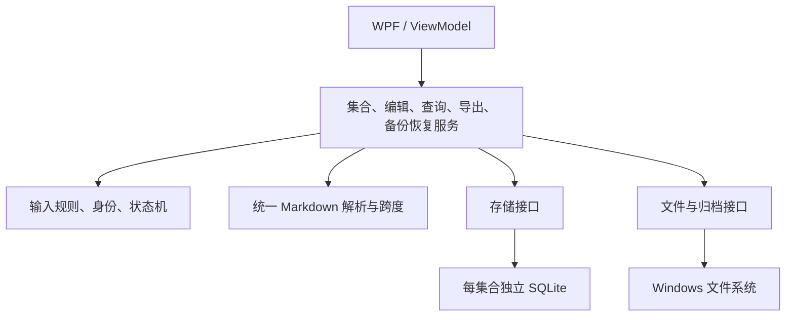

# 个人 Markdown 笔记与知识管理工具：软件设计文档

- 实验：软件设计文档生成（架构设计与系统设计）。
- 版本：实验二软件设计文档定稿，依据用户已核对并认可的 r2 整理。
- 整理日期：2026-10-12。
- 状态：用户已完成设计内容、需求范围、CB01／CB02、追踪矩阵及验证状态的审查和最终确认。本文为设计定稿，该确认不表示软件验收。
- 实施状态：系统尚未开发。功能、性能、离线、故障、隐私及兼容性验收均未执行。
- 验证区分：本文的产品验证为计划；附录中的独立 SQLite 小样例只核对部分设计语句和关系约束，不是软件实现或功能验收。

## 前轮一致性修订摘要

| 问题 | 采用的修订 | 影响位置 |
|---|---|---|
| 恢复后的笔记字段与集合级回执含义不一致 | 保留集合级 RESTORE_INIT；每篇存活恢复笔记另建 RESTORE_NOTE_INIT，lastCommitId 指向该笔记自己的回执。API11 仅核实当前集合、当前待核实操作的 SAVE | SD04.1／7、API09／11、F08／09、V13／16、附录 |
| 导出示例偏离第一关用户可见文本 | 恢复 FR09 的“内部引用／失效内部引用”、跳转限制与分类原因；特殊字符转义仅为生成普通文本的实现细节 | SD06.4、API07、F06、V07 |
| 备份来源识别字段不完整 | 清单明确保存来源位置、实际快照捕获时间、已保存笔记数；显示和恢复核对一致，恢复不访问原位置 | SD04.6、API08／09、F07／08、V08／16 |
| 澄清与设计来源易混淆 | 单列 CB01、CB02 的理由、受影响需求和验证；不倒填为第一关原文 | SD14 |

## 设计补充要点

- SD11 增加 WPF／跨平台桌面方案、SQLite／独立 Markdown 文件的优点、代价与选择理由。
- SD09.2 集中说明模块接口、解析／存储适配层及拟检查方法；SD12／V14同步定位，不新增需求编号。
- SD02保留同一架构图，并补文字依赖链以适应不能渲染Mermaid的阅读器。业务规则、CB01／CB02及SQL样例结论不变。

<a id="SD01"></a>

## SD01　依据、范围与统一状态

### 1.1 需求来源与范围

需求依据为公开仓库的[第一关需求分析文档](https://github.com/clairvoyanttt/personal-markdown-knowledge-base/blob/main/docs/requirements.md)。导出和备份规则与其中 FR09、FR11 对齐。需求编号、优先级和首版范围保持不变。

首版为 Windows 11 上面向学生与知识工作者的个人、本地、离线工具，围绕“记录—组织—查找—关联—输出”使用。学生课程笔记、复习整理和知识工作者专题积累是设计场景，不代表开展过用户访谈。

| 类型 | 编号与范围 |
|---|---|
| 首版功能 | FR01—FR11、FR16，共 12 条 |
| 首版非功能 | NFR01—NFR06，共 6 条 |
| 范围外编号 | FR12 同步、FR13 插件／主题、FR14 移动端、FR15 协作 |

共 18 条首版需求，15 条高优先级、3 条中优先级；中优先级的 FR03、NFR03、NFR04 仍需验收。不增加自动保存、回收站、历史版本、崩溃草稿恢复、集合删除／合并／并行打开、跨集合引用、AI、OCR、PDF／HTML 或附件打包。

### 1.2 状态定义

| 术语 | 含义 |
|---|---|
| 集合／活动集合 | 有独立标识和本地位置的数据单元；一次只有一个活动集合 |
| 候选集合 | 创建或验证中的目标，尚不承接活动编辑 |
| 草稿 | 本会话内存中的名称、正文、标签及引用修改；不承诺退出后恢复 |
| 已保存版本 | 最近一次已确认持久化成功的内容 |
| revision／collectionRevision | 笔记版本／集合变更版本；保存、删除等成功事务推进相应版本 |
| commandId | 一次持久化命令的唯一标识，用于核实该命令 |
| operationId | 操作批次标识；普通保存与 commandId 相同，恢复时关联集合及各笔记初始化回执 |
| contextGeneration | 活动上下文代次，用于丢弃旧集合的迟到结果 |
| 发布／激活 | 正式有效文件成为可打开集合／应用安装其活动上下文；二者完成点不同 |

### 1.3 内容版本规则

编辑和预览使用当前草稿；笔记列表名称、标签筛选、标题／正文搜索、目标名称、其他笔记反向引用、导出和备份使用已保存版本。正文、名称、标签和引用的修改均需手动保存。预览等读取操作不得隐式保存。

CB02 待核实期间，内存编辑保留；旧列表和关系标注“最后已确认状态”，不得冒充刚从数据库确认的当前结果。

<a id="SD02"></a>

## SD02　架构、部署与运行视图

### 2.1 技术选择

C#／.NET 10／WPF、MVVM 和每集合独立 SQLite 是本实验经用户接受的设计选择，不是第一关规定的技术实现。拟用 AvalonEdit 编辑适配层、Markdig 解析适配层及 Microsoft.Data.Sqlite 存储适配层；具体依赖版本和许可证在实现时记录，不声称已安装或完成兼容验证。

| 选择 | 理由与代价 |
|---|---|
| WPF／MVVM | 适合 Windows 桌面交互和可观察状态；首版不支持跨平台界面 |
| 独立 SQLite | 正文、标签、身份与引用在一个事务中更新；需导出 Markdown，不能将数据库当普通笔记文件编辑 |
| 统一语法树及原文跨度 | 保存、预览、导出、恢复一致；需要验证跨度和保护范围 |
| WPF 预览 | 不执行 HTML 脚本、不自动加载远程资源；原始 HTML 不作为首版渲染承诺 |
| 离线部署包 | 拟包含运行依赖；安装及核心运行无需在线账号或服务 |



即使阅读器不渲染图，也可按这条依赖链理解：WPF界面／视图模型调用应用服务；应用服务依赖领域规则、统一Markdown解析、存储接口和文件接口；存储接口由SQLite适配层实现，文件接口由Windows文件／归档适配层实现。解析边界对应M04，数据库和文件适配对应M09。接口表达业务输入、版本和结果，不把WPF控件或SQL连接传入领域规则。

领域规则不依赖 WPF 或 SQL。基础设施实现接口，界面不直接执行数据库操作。

### 2.2 运行及部署

| 执行部分 | 职责与约束 |
|---|---|
| UI 线程 | 输入、对话框、状态显示、受控活动上下文切换 |
| 每集合串行存储队列 | 写事务、一致快照、提交核实；不交错执行本应用写入 |
| 解析／查询任务 | 携带编辑版本、查询编号及上下文代次；结果过期即丢弃 |
| 文件任务 | 使用冻结快照生成导出、备份、恢复候选文件 |
| 集合协调器 | 统一未保存保护、发布、激活和资源所有权 |

候选集合可短暂拥有验证连接，不提供第二个活动编辑环境。拟采用应用单实例控制。正式集合文件为 knowledge.sqlite；本地应用配置只记录必要位置、身份和诊断信息，不记录正文。导出为 .md；备份拟为 .pmkb ZIP 容器。不存在后端服务器、账号和云数据库。

<a id="SD03"></a>

## SD03　模块职责与依赖

| 模块 | 职责 | 依赖／限制 |
|---|---|---|
| M01 界面与视图模型 | 入口、状态、确认和反馈 | 应用服务；不直接写库 |
| M02 集合协调 | 创建、打开、切换、发布和激活 | M03、M09；统一草稿保护 |
| M03 编辑与持久化 | 草稿、保存、删除、回执核实 | M04、M09 |
| M04 解析与引用 | 语法树、保护跨度、出现项及分类 | 无独立持久化副作用 |
| M05 已保存查询 | 筛选、搜索、反向引用 | M09；不能用草稿替代保存事实 |
| M06 预览 | 当前编辑效果 | M04；目标状态取已确认数据 |
| M07 导出 | 单篇保存版本的文本转换 | M04、M09 |
| M08 备份恢复 | 快照、清单、转换、初始化 | M04、M09 |
| M09 基础设施 | SQLite、事务、文件、归档 | 集中连接配置和错误转换 |

<a id="SD04"></a>

## SD04　数据模型、约束与一致性

### 4.1 主要实体

集合、笔记、提交及批次标识均为 32 位小写十六进制文本。身份使用至少 128 位随机性或等效方式产生并检测已知冲突，不从名称、位置或序号推导。删除或缺失保留身份不复用。

| 实体 | 主要字段 | 语义与约束 |
|---|---|---|
| CollectionMeta | singletonId、collectionId、schemaVersion、collectionRevision、state | 单行；正式集合须 READY；恢复后新集合版本初始化为 1 |
| NoteKeys | noteId、state、liveNoteId、lastSavedName | LIVE／DELETED／MISSING_RESERVED 身份账本；已删除名称保留 |
| Notes | noteId、keyState、name、nameKey、body、revision、lastCommitId | 当前保存内容；必须对应 LIVE；lastCommitId 指向产生该笔记版本的笔记级回执 |
| NoteTags | noteId、tag | 同笔记同标签唯一；BINARY 区分大小写 |
| RefOccurrence | sourceNoteId、sourceRevision、ordinal、targetCollectionId、targetNoteId、startUtf16、lengthUtf16、displayHint | 保存正文的派生出现项；不存另一份权威目标分类；提示不作为身份依据 |
| CommitReceipt | commandId、operationId、collectionId、operationKind、noteId、beforeRevision、afterRevision、collectionRevision | 事务证据，无历史正文；具体类型见下表 |

| 回执类型 | noteId／修订字段 | lastCommitId 与 API11 的关系 |
|---|---|---|
| SAVE | noteId 必填；新笔记 beforeRevision 为空，否则为旧版本；afterRevision 为新版本 | 成功保存的 Notes 指向它；API11 可核实匹配的本集合待核实 SAVE |
| DELETE | noteId 必填；beforeRevision 为删除前版本；afterRevision 为空 | 无存活 Notes 指向它；保存核实不接受该类型 |
| RESTORE_INIT | noteId、前后笔记修订均为空；operationId 等于 commandId | 集合级初始化证据；任何 Notes 都不指向它 |
| RESTORE_NOTE_INIT | noteId 为对应恢复笔记；beforeRevision 为空；afterRevision 等于保留的笔记 revision | 每篇恢复笔记有不同 commandId，lastCommitId 指向自身回执；API11 不把它当 SAVE |

恢复的集合级回执和逐篇回执共享同一个新 operationId、归属新集合、collectionRevision 为 1。零篇笔记的恢复只有集合级回执。普通 SAVE／DELETE 的 operationId 等于各自 commandId。首版不自动清理回执，以保留核实证据覆盖；这不提供版本历史功能。

### 4.2 内存模型

DraftBuffer 保存 bufferId、可空 noteId／baseRevision、名称／正文／标签、editVersion 和修改状态。全新草稿没有已保存版本。PendingSave 保存命令标识、拟用身份、冻结草稿和原保存状态。SavedSnapshot 保存一次一致读取的集合版本；ParsedDocument 保存语法树及跨度；ActivationTicket 保存原代次、目标、发布状态和暂存资源。

### 4.3 数据库与应用的职责分工

| 规则 | 数据库保证 | 应用／事务检查 |
|---|---|---|
| Notes 与 LIVE 身份双向存在 | 双向延迟外键、CHECK、NOT NULL | 打开和恢复检查模式及历史数据 |
| 源出现项属于正确修订 | Notes(noteId, revision) UNIQUE 与复合外键 | 原文标记、跨度、顺序和解析结果一致 |
| 删除源后不留标签／出站项 | ON DELETE CASCADE | 确认身份、修订号和用户选择 |
| 名称唯一／标签不重复 | nameKey UNIQUE／复合标签主键 | 先拒绝基线控制字符，再裁剪；码点长度、20项上限；nameKey 仅折叠英文 A—Z，不做额外正规化 |
| 身份不修改、不删除、不复用 | 触发器；只允许 LIVE→DELETED 或原状态 | 生成时排除已知身份；缺失身份保留 |
| 目标删除、缺失、第三集合可存 | 不对引用目标设置必须指向存活 Notes 的外键 | 先判集合归属，后判目标状态；不得按名称回退 |
| 回执与笔记版本一致 | 标识唯一及回执字段形状 CHECK | lastCommitId 的回执须匹配集合、笔记、操作类型和 afterRevision；SAVE 内容与提交快照一致 |
| 递增、并发和索引语义 | 修订正数、关系约束 | 预期旧版本匹配；标签数量、跨度范围、不重叠及派生数据完整 |

lastCommitId 不靠“某个回执存在”就证明业务正确：本设计不设置这一简单存在性外键，采用上述语义检查；恢复初始化和每次保存均须执行。核心 DDL 见[附录 A](#appendix-a)。

名称去空白后 1—100 个 Unicode 码点，标签 1—30 个，每篇最多 20 个不同标签；先拒绝 U+0000—U+001F、U+007F，再裁剪允许的首尾空白。名称英文判重不分大小写并排除自身；标签区分大小写。UTF-16 偏移不能充当码点长度。1000篇／10KB 不是容量上限。

### 4.4 连接与更新顺序

每个连接在事务前执行 PRAGMA foreign_keys=ON 并读取确认值为 1；包括查询、候选、快照验证和恢复连接。父键组合须完整匹配唯一约束；双向外键为 DEFERRABLE INITIALLY DEFERRED、NO ACTION，不用立即处理的 RESTRICT。[SQLite 官方规则](https://www.sqlite.org/foreignkeys.html)。

首次保存在一个事务插入 LIVE 身份、Notes、标签、出现项、缺失身份、SAVE 回执并推进集合版本。再次保存检查 baseRevision，删除旧出站项、更新正文和修订、替换标签／新出现项，同步账本名称并写回执。

删除先将身份改为 DELETED、清空 liveNoteId、保留名称，再删除 Notes；标签和出站项级联删除，其他笔记的入站项保留。删除及回执、集合版本处于同一事务。

延迟约束提交失败不等于事务自动结束，须显式回滚。只有确认未写入或已回滚才报告普通失败；不能确认时进入 CB02。

### 4.5 快照与权威事实

snapshot.sqlite 中的保存正文、Notes、NoteKeys、标签、集合元数据是权威业务事实；RefOccurrence 是需重解析核对的派生索引。引用状态由快照集合标识和身份数据计算，不由 manifest 覆盖。

### 4.6 manifest.json 字段与核对

| 字段 | 类型／来源 | 恢复核对与用途 |
|---|---|---|
| formatVersion、schemaVersion | 受支持的整数版本 | 不支持则拒绝 |
| snapshotEntry | 固定字符串 snapshot.sqlite | 必须有且不重复；禁止目录穿越 |
| sourceCollectionId | 快照 CollectionMeta 的集合标识 | 与快照一致；供归属转换 |
| sourceLocation | 捕获时活动集合完整本地目录，非空字符串 | 给用户识别；核对字段格式，不要求目录存在，不访问该路径 |
| backupCapturedAtUtc | 捕获服务在实际冻结快照时读取系统时钟生成的 UTC 时间，ISO 8601 带 Z | 必须可解析；显示时明确时区；不是预填时间、需求批准时间或事后猜测时间 |
| sourceCollectionRevision | 快照集合修订号 | 与快照一致 |
| savedNoteCount | 快照 Notes 行数，非负整数 | 重新计数一致，不包含草稿或已删除身份 |
| referenceCounts | valid／deleted／missing／foreign 四个非负计数 | 按快照重解析分类逐出现次数核对，不是去重目标数 |

来源位置与捕获时间的识别信息以清单为记录来源，由捕获服务从活动上下文和实际时钟写入；它们不能从笔记正文反推。恢复只核对存在、格式和可读性，不声称证明原设备时钟准确或该历史路径真实可达。集合标识、版本、数量和分类则以 snapshot.sqlite 为准，清单仅核对。清单不另存逐引用分类。

同一捕获操作绑定 sourceLocation、sourceCollectionId 和快照，防止切换后混入另一集合。backupCapturedAtUtc 定义为成功备份所含快照的实际捕获时间，不称为最终文件发布完成时间。失败不报告有效备份；不提供签名或来源真实性认证承诺。

### 4.7 恢复初始化一致性

恢复先在暂存副本分类并转换，再在一个事务内：更换集合标识、设 collectionRevision=1、删除全部复制来的旧回执、生成新的 RESTORE_INIT、为每篇 Notes 生成不同的 RESTORE_NOTE_INIT，并设置对应 lastCommitId。各笔记 revision 保留；前版本为空表示初始化，不能解释成此前在新集合保存过。

提交前检查：每篇 lastCommitId 都匹配新集合、该 noteId、RESTORE_NOTE_INIT 和 afterRevision；没有笔记指向集合级回执；没有旧回执残留；正文／标签／出现项及身份约束一致。后续手动保存产生新 SAVE 并推进该笔记 revision，lastCommitId 才更新到 SAVE。

API11 必须使用“当前集合＋待核实 commandId＋SAVE 类型＋笔记＋前后版本＋提交内容”核实；旧集合回执、集合级初始化、逐篇初始化均不能证明新的 SAVE。原集合和备份文件不修改。

<a id="SD05"></a>

## SD05　内部、外部接口与错误约定

### 5.1 共同约定

调用携带集合标识、contextGeneration 及必要的预期版本。结果为 OK、ERROR、CANCELLED、PARTIAL、UNCONFIRMED；分别表示完成、明确失败、无本次新增持久化效果的取消、部分完成、结果未知。错误含业务码、可读原因和后续动作；日志不包含正文。

| 编号／接口 | 输入 | 输出 | 错误／调用限制 |
|---|---|---|---|
| API01 Prepare／Complete／CancelActivation | CREATE／OPEN、目标位置、原代次、逐草稿选择及编辑版本 | 发布状态、激活状态、集合标识、正式位置 | 统一未保存保护；已发布未激活为 PARTIAL；只清理未发布自有资源；旧票据拒绝 |
| API02 CreateDraft／Load／ApplyEdit／SaveNote | 名称、身份、编辑补丁；保存含命令、冻结快照、baseRevision | 草稿、保存修订或待核实状态 | 非法、重名、版本冲突；普通失败保留输入；不明确进入 CB02 |
| API03 DeleteNote／CheckDelete | 身份、预期修订、删除及未保存内容确认；核实含原DELETE命令 | 删除结果、新集合版本或未核实状态 | 无确认不删；未知结果核对本集合DELETE回执、对应删除前版本及DELETED／无正文状态，不调用SAVE核实分支 |
| API04 QuerySaved | 查询编号、关键词／标签、上下文 | 完整结果、数量、集合版本 | 仅保存版本；空查询清旧结果并提示；迟到结果丢弃 |
| API05 Build／ResolveReference、ListBacklinks | 已保存目标、合法插入偏移；标记及保存视图 | 完整标记、名称／原因、去重源笔记列表 | 插入只改草稿；不按名称或局部标识回退；反向引用仅保存项 |
| API06 BuildPreview | 当前正文、编辑版本、已确认目标视图 | 版本化预览 | 不写库；不执行脚本；旧结果丢弃 |
| API07 ExportNote | 当前选择、目标文件、未保存处理选择 | 路径、所用修订 | NO_SAVED_VERSION；先提示，保留 FR09 文本；已有文件拒绝；待核实阻止 |
| API08 BackupCollection | 目标文件、未保存选择、上下文 | 备份路径、来源标识／位置、实际捕获时间、保存数量及版本 | 草稿排除并提示；冻结快照生成清单；不覆盖；待核实阻止 |
| API09 RestoreBackup | 备份、空目标 | 新集合、位置、数量及来源识别信息，不激活 | 校验清单／快照；初始化逐篇回执；不访问来源位置；异常不改原数据 |
| API10 CommitMutation／ReadSavedSnapshot | 校验后的变更、预期版本；读取请求 | 事务结果或一致快照 | 仅应用服务调用；统一连接设置、参数化 SQL 和证据检查 |
| API11 CheckCommit／CloseUnconfirmedSession | PendingSave、原保存状态；明确退出风险确认 | COMMITTED／NOT_COMMITTED／UNRESOLVED，或带未知提示的关闭 | 仅接受本集合匹配 SAVE；找不到回执不直接等于失败；不自动重写、不承诺草稿恢复 |

错误码包括 INVALID_NAME、DUPLICATE_NAME、INVALID_TAG、TAG_LIMIT、REVISION_CONFLICT、NO_SAVED_VERSION、TARGET_EXISTS、TARGET_NOT_EMPTY、INVALID_BACKUP、SCHEMA_UNSUPPORTED、STALE_CONTEXT、COMMIT_UNCONFIRMED。DELETED／MISSING／FOREIGN_COLLECTION 是正常引用分类，不统一报为数据库损坏。

### 5.2 外部接口

Windows 文件接口接收用户选定的合法位置，返回实际路径或具体错误；已有导出／备份不覆盖。SQLite 仅经 M09 的参数化事务调用。解析器接收原文并返回树及跨度，不联网。ZIP 只接受规定关键条目，拒绝重复、缺失、目录穿越或不支持格式。

外部链接仅在用户明确操作后交给系统关联程序。图片和附件路径作为原文保留，不下载、不打包、不保证迁移后可用。应用配置中的身份登记用于冲突检测，不增加最近使用列表需求。

<a id="SD06"></a>

## SD06　解析、引用、导出和保存状态

### 6.1 同一解析与跨度规则

先解析 Markdown，再确定代码、完整外部链接及其目的地址／标题、图片或附件链接、被转义开头等保护跨度；仅在剩余可识别文本寻找完整内部标记。保护跨度优先，不把外部链接内部的类似标记另建引用。保存、预览、导出、恢复共享此结果。

标记为 [[note:<32位小写十六进制集合标识>:<32位小写十六进制笔记标识>]]，完整原文长 74 个 UTF-16 单元。源码位置使用 UTF-16 偏移，插入不可分割代理项。按原文跨度从后向前替换，不重序列化整篇 Markdown；未规定转换的原字符保留。

### 6.2 分类与呈现

| 条件 | 状态与处理 |
|---|---|
| 本集合、LIVE 且 Notes 存在 | 有效，显示当前保存名称，按 FR06 激活目标 |
| 本集合、DELETED | 显示“失效引用：原目标名称（目标已删除，无法跳转）” |
| 本集合、目标不存在／缺失保留 | 显示“失效引用：未知目标（目标标识不存在或不可用，无法跳转）” |
| 集合标识不同 | 显示“失效引用：可用原目标名称或未知目标（引用来自其他集合，无法跳转）” |
| 不完整语法或受保护代码 | 普通文本／代码，不建关系 |
| LIVE 与正文矛盾 | 数据异常，不猜测替代目标 |

先判集合归属；改名保留身份和源标记；删除后同名重建不复活旧引用。目标未保存名称不进入名称提示。名称提示按文本控件呈现，不重新当 Markdown 解释。本轮不增加未保存引用跳转验收。

### 6.3 恢复转换

| 快照中的类型 | 归属转换 | 保持结果 |
|---|---|---|
| 来源集合有效目标 | 转为新集合标识，笔记标识保留 | 指向恢复对应笔记 |
| 来源集合已删除目标 | 转归属，保留删除身份和历史名称 | 保持删除原因，无替代正文 |
| 来源集合不存在目标 | 转归属，保留／建立缺失保留身份 | 保持不存在原因，不复活 |
| 第三集合标记 | 不转换 | 仍为外来引用 |
| 代码、保护跨度、不完整标记 | 不转换 | 原文保持 |

新集合标识排除来源、已知集合及快照第三集合标识。正常失效不视为损坏；LIVE 缺正文、非 LIVE 有正文、身份／名称约束矛盾、出现项与原文或版本不符、清单计数不符及归档异常才拒绝。普通粘贴不执行归属转换。

### 6.4 与 FR09 一致的导出文本

以下保持第一关确认的用户可见文本，不再使用第 3 版中简化的“引用：”前缀：

```text
内部引用：数据结构复习（仅供识别，导出后不支持应用内跳转）
失效内部引用：数据结构复习（目标已删除，无法跳转）
失效内部引用：未知目标（目标标识不存在或不可用，无法跳转）
失效内部引用：未知目标（引用来自其他集合，无法跳转）
```

若外来目标有可信的可用历史名称，可替换“未知目标”；不按名称猜测本地笔记。有效引用取当前已保存目标名称；删除引用取历史名称。输出不保留完整标记，也不生成 Markdown／Wiki／应用／HTML 内部链接。

特殊字符转义是实现普通文本结果的方式，不能删去前缀、原因或限制说明。对生成文本中的原始名称单次逐字符转义 ASCII 标点，不连续替换已生成反斜杠。[CommonMark 转义依据](https://spec.commonmark.org/0.31.2/#backslash-escapes)。例如原名称：

```text
[方] <角> \ &amp; `码` https://example.com/a?x=1&y=2
```

导出文件中的有效／已删除原文分别为：

```text
内部引用：\[方\] \<角\> \\ \&amp\; \`码\` https\:\/\/example\.com\/a\?x\=1\&y\=2（仅供识别，导出后不支持应用内跳转）
失效内部引用：\[方\] \<角\> \\ \&amp\; \`码\` https\:\/\/example\.com\/a\?x\=1\&y\=2（目标已删除，无法跳转）
```

在选定 CommonMark 解析方式中，名称应保持可读；方括号不建链接，尖括号不建 HTML／自动链接，反引号不建代码，反斜杠和字面 `&amp;` 正确呈现。生成文本不启用裸网址自动链接扩展。原正文外部链接、代码、图片及附件路径不采用此转义，保持原文。

第一关不保证第三方阅读器全部渲染行为；有的阅读器可能自行链接化呈现后的网址文本。首版仍保证不保留应用内部跳转能力，并明确提示此边界，不宣称任何第三方均不可点击。

### 6.5 保存状态与证据

状态为已保存、未保存、保存中、普通保存失败、保存结果待核实。普通失败仅在确认未写入或已回滚时成立，保留旧保存版本和草稿。

API11 的 COMMITTED 要求本集合匹配 SAVE 回执、笔记及前后修订、lastCommitId 和保存内容吻合；不接受 RESTORE_INIT、RESTORE_NOTE_INIT 或旧集合证据。NOT_COMMITTED 要求确认原事务已经结束且未提交、旧数据仍成立及证据覆盖充分。否则 UNRESOLVED；仅未找到回执不足以判失败。

确认保存成功只标记捕获的 editVersion，后续编辑仍未保存。待核实期间允许内存编辑／预览，暂停新保存、删除、导出、备份、活动切换及未核实查询刷新。

<a id="SD07"></a>

## SD07　关键正常与异常流程

### F01　集合新建、打开与切换

准备目标时保留原上下文。最终操作前重新核对全部草稿及编辑版本，逐项执行保存／放弃／取消；保存必须成功，放弃仅记录待生效选择。新建验证后以不覆盖方式发布，再安装目标上下文；真正激活时才清除获确认放弃的草稿。所有可能失败的目标准备先于该切换完成点。

发布前取消、保存失败、目标失败：保留原集合与编辑，清理自有未发布暂存。已发布但激活取消／失败：保留正式集合，返回“已创建，未打开”及位置，保留原草稿，用户以后可按同一保护规则打开。已成功保存不回滚。激活后的旧资源释放异常不误报为未切换。

发布本身未知时不删除可能正式的文件。清理限于本次可确认尚未发布的资源，不递归清目标目录、不删用户文件。目标非空新建拒绝。恢复的发布也遵守这一边界，但恢复正常完成不自动激活。

### F02　手动保存

冻结快照→名称／标签／引用和 baseRevision 校验→SD04 事务→确认后更新列表、筛选、搜索和反向引用。合法且未占用的新名称可保存；另一篇已有名称拒绝，自身排除。明确失败保留草稿和旧事实；未知进入 F09，不自动重复提交。

### F03　删除

显示对象与未保存内容会被删除的确认；取消保留。确认后按 SD04 删除顺序提交，成功才关闭编辑项和更新失效提示。失败／未知不提前显示成功。

### F04　筛选与搜索

只查保存名称及正文，连续字面匹配、英文不区分大小写；标签按原规则区分大小写。空／全空白查询提示并清旧结果，其他查询不暗中裁掉有意义空格。无结果显示零和条件；旧查询或旧集合结果丢弃。

### F05　引用

插入命令选本集合已保存目标，生成完整标记使草稿变脏；保存后重建出现项和反向引用。改名更新目标显示而不改源标记；删除、缺失、外来有各自文字原因；不按名称或局部标识替代。

### F06　单篇导出

无保存版本拒绝并提示先保存（CB01）。存在未保存修改时提示“导出不包含这些修改”，可返回保存或继续；同时提示内部引用不能继续应用内跳转、附件不打包。冻结保存内容，按 SD06.4 文本及原文跨度转换。

默认名为 note-<处理后的已保存名称>.md：禁用字符替换为下划线、移除名称部分末尾点／空格；该部分为空用 note.md。课程/笔记→note-课程_笔记.md；CON→note-CON.md；复习.md→note-复习.md.md。另选名称缺扩展时追加 .md，已有 .MD 不重复追加；非法或不可写允许重选，已有文件拒绝覆盖，不静默截断或改变笔记名。

暂存完整文件后发布；成功显示位置，失败清自有未发布暂存，不改源笔记或旧文件。

### F07　备份

检查全部未保存修改，包括新草稿；提示“本次备份不包含这些修改”，返回保存不备份，继续只用保存版本。固定活动上下文，在串行队列捕获一致快照并记录 sourceLocation 和实际 backupCapturedAtUtc；从快照生成数量、版本及分类计数。源位置只识别，不作为恢复目的地。

验证后不覆盖地发布。成功界面显示：备份文件位置、来源集合位置、实际捕获时间及其时区、已保存笔记数，并可附标识／版本。切换到 B 后下一次备份来源必须为 B，不混入 A。后续保存不改已捕获快照。失败不报有效备份。

### F08　独立恢复

选备份和空目标→校验规定条目及清单字段→从快照核对版本、数量、引用计数→按原分类转换暂存副本→SD04.7 初始化回执→一致性核对、提交、发布。正常删除／缺失／外来引用允许恢复。

恢复预览可显示来源位置、捕获时间和保存数量；不打开、不验证可达性、更不写入 sourceLocation。成功显示新位置和实际恢复笔记数，提供打开入口但不自动切换；打开仍走 F01。失败不改原集合、备份或目标原有内容。

### F09　CB02 核实与退出

保留提交快照和当前内存，显示“保存结果待核实”，核实前不重写。数据库持续不可读时，可保持会话继续编辑／手动核实，或取消退出；也可明确选择“退出并放弃本会话内存编辑，提交结果仍未知”。

该退出需再次说明：数据库提交结果不能确认；退出丢失全部仅在本会话的编辑；不因此宣称回滚，也不保证下次恢复内存草稿。确认后停止新操作、待已发出数据库调用结束再释放资源，不删数据库或回执来消除未知。底层调用未结束时说明正在等待；操作系统强制终止不作保证。下次仅加载实际持久化数据。

<a id="SD08"></a>

## SD08　界面与交互

主界面含集合入口与位置、保存笔记列表、筛选／搜索和结果数、名称／正文／标签编辑、Markdown 预览、反向引用及保存／删除／导出／备份／恢复入口。无活动集合时编辑、集合查询及备份提示先新建／打开，恢复仍可用。

预览覆盖标题、段落、列表、链接、引用、围栏代码块，并呈现当前草稿。所有修改有未保存标记。错误给出操作、原因和可选后续动作，不能只显示“发生错误”。失效原因采用文字，不只靠颜色。

普通关闭／退出提供保存、放弃、取消，对全部草稿保护。CB02 使用专门的未知状态与退出提示。已发布未激活显示“已创建，未打开”及打开入口；备份成功显示 SD04.6 的识别信息；恢复成功仅显示结果与打开入口。

<a id="SD09"></a>

## SD09　非功能设计

### 9.1 基线非功能需求的设计响应

| 需求／优先级 | 设计措施 | 拟判定方法 |
|---|---|---|
| NFR01／高 | 本地核心服务及离线依赖，外部网页另行处理 | 断网执行集合及笔记核心流程 |
| NFR02／高 | 事务、关系约束、证据核实、暂存发布、非覆盖 | 故障注入核对保存事实、草稿与反馈；不承诺全部硬件故障可恢复 |
| NFR03／中 | 后台查询、参数化访问、一致快照 | 1000篇，每篇UTF-8正文≤10240字节；固定30次至少29次≤2秒且正确完整 |
| NFR04／中 | 可读入口、状态、错误和确认 | 操作脚本观察反馈，不以“方便”替代判定 |
| NFR05／高 | 无账号、自动上传、正文遥测或自动外部资源加载 | 网络及依赖检查；显式打开网页另说明 |
| NFR06／高 | Windows11、码点与UTF-16分工、UTF-8输出 | 实际环境执行中文／英文／符号／换行及路径用例 |

性能是目标，不是达标记录或容量上限。测试前固定数据集、长度／中英文分布、标签引用量、30条非空查询及顺序、预期结果、载入就绪状态、预热、后台负载及统一计时工具；从提交至完整结果可见计时，全部30次计入，不剔除慢项。执行时记录实际 CPU、内存、存储、目录、Windows11和应用版本，不预填设备。

### 9.2 可维护性与可扩展性设计

这里的可扩展性是开发者在代码内部修改或替换模块的能力，不是首版用户扩展功能。首版仍只有WPF界面和SQLite存储，不提供插件加载、同步或移动端。以下是本实验的设计质量约束，不新增NFR编号，也不改变原18条需求。

| 边界 | 怎样限制修改影响 | 拟检查方法与判定 |
|---|---|---|
| 模块接口与依赖 | M01调用界面所需的应用服务入口，API10仍仅供应用服务内部调用；需要持久化／文件操作的服务通过接口使用M09，M04保持纯解析边界。领域校验不依赖界面和数据库具体类型，返回对象按SD05携带相应身份、版本及错误状态 | 实现后检查项目引用与调用点：领域规则出现WPF／Microsoft.Data.Sqlite具体类型、M01直接SQL、M05读取DraftBuffer作为查询事实，均判为未落实 |
| 解析适配层M04 | 将Markdig结果转换为本系统的ParsedDocument、保护跨度和引用出现项；M03／M06／M07／M08不直接依赖第三方语法树。升级解析器只在适配边界处理差异，不改引用归属规则 | 用同一固定样例核对六类Markdown、代码内标记、跨度及有效／失效分类；升级前后应与记录的预期一致，并运行V03／V05／V07／V09相关用例。样例集和预期待后续准备 |
| 存储适配层M09 | 封装连接、参数化SQL、事务、快照和回执；向应用返回SavedSnapshot与操作结果，不暴露SqliteConnection。未来替换实现必须保留手动保存、身份账本与提交核实契约，不承诺可直接互换 | 按API10／11检查保存版本、失败／未知状态和回执归属；可用测试替身注入结果，但真实SQLite事务仍须验证。替身不是第二种首版产品存储 |
| 变更与回归 | 在模块边界记录依赖版本和接口变更，按受影响的V01—V16选择回归。数据库模式不支持时仍拒绝打开，不悄悄迁移或覆写 | 审查每次变更的接口／模式影响及相应验证记录；未执行的验证不能标通过，改变已确认业务规则须另列需求变更供审查 |

这些措施与SD02的接口依赖和SD03的模块职责一致，帮助检查NFR02的数据完整性及NFR06的兼容性。依赖和适配契约检查归入V14，具体行为仍追踪原FR／NFR；全部为后续检查计划，尚无产品代码或验证结果。

<a id="SD10"></a>

## SD10　故障处理

| 故障 | 策略 |
|---|---|
| 非法／重名／超限 | 拒绝变更，保留输入、旧事实及关系，不截断 |
| 明确事务失败 | 显式回滚并确认；保留草稿 |
| 未知提交／持续不可读 | F09，不混为普通失败，不自动重写 |
| 删除／缺失／外来引用 | 正常失效提示，不猜测换绑 |
| 查询失败／无结果 | 分别反馈错误／零结果，旧列表不冒充当前结果 |
| 文件不可写／已有目标 | 说明原因，重选／取消；不覆盖旧文件 |
| 备份矛盾／模式不支持 | 拒绝恢复或打开；不自动修补／迁移 |
| 发布成功、激活失败 | F01，保留正式集合和原草稿 |
| 暂存清理失败 | 报告残留位置，不扩大删除范围 |
| 迟到任务 | 按版本／代次丢弃 |

<a id="SD11"></a>

## SD11　设计决策与取舍

### 11.1 两项关键方案比较

| 方案 | 优点 | 代价与本项目判断 |
|---|---|---|
| WPF（采用） | 提供XAML、数据绑定、命令、布局和Windows桌面控件，可沿用已选编辑／预览适配方向 | 仅Windows；若将来改为其他平台需重做界面适配。首版明确Windows11，没有跨平台验收，因此选择C#／.NET10／WPF，集中完成保存与数据保护规则 |
| 跨平台桌面框架，例如Avalonia（备选） | 可用.NET及XAML风格构建Windows、macOS、Linux界面，利于未来复用部分UI和业务代码 | 平台行为、文件／剪贴板及编辑预览组件仍需分别验证，不能把现有WPF控件视为自动可替换。本首版不需要这些平台，采用它会引入本轮无验收收益的适配工作，故不采用 |
| 每集合SQLite（采用） | 一个事务内更新正文、标签、身份、出现项和回执，可声明唯一／外键约束；适合已选集合快照与独立恢复设计 | 用户不能直接用文本编辑器编辑数据库，需FR09导出；模式及连接配置需维护。手动保存的关联一致性是本项目重点，故选用SQLite，性能仍待测试 |
| 独立Markdown文件加元数据／索引（备选） | 正文可直接由文本工具读取，文件可逐篇处理，格式可见 | 标签、身份、删除账本、回执及索引不能只靠正文文件表达；需要额外元数据、跨文件提交／恢复协议，处理正文与索引半更新。可以设计实现，但本课程首版工作量更多，故不采用；不额外承诺外部编辑器写入工作流 |

平台与控件能力参考[Microsoft WPF说明](https://learn.microsoft.com/en-us/dotnet/desktop/wpf/overview/)和[Avalonia官方说明](https://docs.avaloniaui.net/docs/welcome)，SQLite适用性参考[SQLite官方说明](https://www.sqlite.org/whentouse.html)。上表工作量和取舍是对本项目范围的设计判断，不是实测性能比较；备选方案未实施。数据库仍保存Markdown原文，单篇导出继续遵守FR09的用户可见输出。

### 11.2 其余决策与边界

| 编号 | 决策与理由 | 代价／边界 |
|---|---|---|
| AD01 | C#／.NET10／WPF | Windows专用设计，不是需求指定 |
| AD02 | 独立SQLite，关联内容事务保存 | 用户通过导出获取Markdown |
| AD03 | 草稿／保存事实分离 | 界面须解释预览与检索版本不同 |
| AD04 | 双段身份引用 | 较长标记通过命令生成，不能跨集合回退 |
| AD05 | 永久删除／缺失身份账本 | 少量记录保留，不是回收站 |
| AD06 | 共用解析和原文跨度 | 增加跨度验证，避免改写无关正文 |
| AD07 | 延迟双向外键加应用检查 | 约束不能替代全部正文语义检查 |
| AD08 | 独立恢复、逐篇初始化回执 | 多些技术回执，换取lastCommitId含义一致；旧证据隔离 |
| AD09 | CB01无保存版本不可导出 | 新草稿先保存，备份排除并提示 |
| AD10 | CB02提交核实 | 异常期间暂停部分操作 |
| AD11 | 发布后保留 | 允许“已创建、未打开”的部分完成 |
| AD12 | 快照业务权威，清单识别和核对 | 计数不一致拒绝，不凭清单改数据库 |
| AD13 | 未核实可明确确认后退出 | 无内存草稿持久化保证 |
| AD14 | 仅生成文本转义，保留FR09文案 | 第三方全部行为不在保证范围 |

<a id="SD12"></a>

## SD12　需求及场景追踪

来源列指第一关对应条目；具体设计为本实验选择，不重标为老师原题。

| 需求／优先级 | 来源 | 设计定位 | 拟验证 |
|---|---|---|---|
| FR01／高 | 基线FR01 | SD04、API02／03、F02／03 | V01／02／06 |
| FR02／高 | 基线FR02 | DraftBuffer、M03、API02 | V02 |
| FR03／中 | 基线FR03 | SD06.1、M06、API06、SD08 | V03 |
| FR04／高 | 基线FR04 | NoteTags、API02／04、F04 | V01／02／04 |
| FR05／高 | 基线FR05 | M05、API04、F04、SD09 | V04／10 |
| FR06／高 | 基线FR06 | SD06.1／2、API05、F05 | V05 |
| FR07／高 | 基线FR07 | RefOccurrence、API05、F05 | V02／05 |
| FR08／高 | 基线FR08 | NoteKeys、SD06.2／3、F03 | V05／06／09 |
| FR09／高 | 基线FR09；CB01另列 | SD06.4、API07、F06 | V07 |
| FR10／高 | 基线FR10；CB02另列 | SD06.5、API02／11、F01／02／09 | V02／13／15 |
| FR11／高 | 基线FR11／D1／D3；CB01另列 | SD04.6／7、API08／09、F07／08 | V08／09／16 |
| FR16／高 | 基线FR16／D1 | API01、F01、SD08 | V09／15 |
| NFR01／高 | 基线NFR01 | SD02／09 | V11 |
| NFR02／高 | 基线NFR02 | SD04／06／09.2／10 | V02／06／08／09／13／14／15／16 |
| NFR03／中 | 基线NFR03 | API04、SD09 | V10 |
| NFR04／中 | 基线NFR04 | SD05／08 | V12／13／15 |
| NFR05／高 | 基线NFR05 | SD02、外部接口、SD09 | V11 |
| NFR06／高 | 基线NFR06 | 文本计数、文件接口、SD09.1／9.2 | V01／07／12／14 |

| 第一关场景 | 对应需求 | 设计／验证关注 |
|---|---|---|
| S01 课程记录 | FR01／02／03／10／16、NFR02／04／06 | 创建与切换、草稿预览、名称自身排除、保存与关闭；F01／02，V01／02／03／15 |
| S02 复习查找 | FR04／05／10、NFR03／04 | 标签、保存搜索、零结果和计时；F04，V04／10 |
| S03 知识关联 | FR01／03／06／07／08／10、NFR02 | 身份、失效、保存前反向引用不更新；F03／05，V05／06 |
| S04 单篇输出 | FR09、NFR02／04／06 | FR09原文案、代码／路径保护、不覆盖；F06，V07 |
| S05 数据保护 | FR10／11／16、NFR02／04／06 | 来源识别、独立恢复、回执隔离和打开保护；F07／08，V08／09／16 |
| S06 离线使用 | FR16、NFR01／05／06 | 离线核心与网络检查分别验证；V11／12 |

FR12—FR15仅为范围外，不分配首版验证。未新增需求编号；V15／16为设计验证组。

<a id="SD13"></a>

## SD13　测试与验证计划

产品验证全部未执行。附录独立样例不代替下列任何整组验收。

| 编号 | 方法与用例 | 判定依据 |
|---|---|---|
| V01 名称／标签 | 空名，100／101码点，控制字符；Note自身操作与另一篇note／NOTE；已有“笔记”时另一篇“ 笔记 ”及新建同名；合法未占用改名；30／31码点、20／21标签 | 按规则接受／拒绝；原数据不变；标签区分大小写 |
| V02 保存与版本 | 仅改名称／正文／标签／引用；普通失败；保存期间继续编辑 | 预览当前、检索保存；失败保留；成功只标捕获版本 |
| V03 预览 | 六类固定样例、连续编辑和迟到结果 | 当前版本正确，不隐式保存 |
| V04 查询 | 连续匹配、英文大小写、空及全空白、无结果、有意义空格、未保存内容 | 正确完整结果，空查询清旧结果 |
| V05 引用 | 插入、保存增删、改名、代码、跨集合同局部标识 | 身份定位正确，保存前反向引用不更新，不换绑 |
| V06 删除 | 取消／确认、事务中断、标签及出站清理、入站保留、同名重建 | 原数据保护或一致删除；旧引用不复活 |
| V07 导出 | 新草稿、未保存提示；有效／删除／缺失／外来；特殊名称、代码、网页、图片；默认命名及已有文件 | CB01正确；逐类匹配SD06.4前缀、名称、限制／原因；非转换跨度字符不变；无有效内部链接、不覆盖 |
| V08 备份 | 保存／未保存／新草稿混合；捕获后保存；切换A／B；时间与上下文记录；失败及已有文件 | 只保存数据；成功显示来源位置、运行时捕获时间和数量，与清单一致；不混集合，不预填时间；失败保护 |
| V09 恢复 | 空／非空目标、四类引用和代码、重复恢复、原位置不可访问、损坏身份 | 新集合独立，正常失效不拒绝；原位置不可访问仍可恢复，不自动切换，不改原集合／备份 |
| V10 性能 | SD09冻结数据、30条查询、预期结果和条件 | 至少29次≤2秒且结果正确；记录真实环境 |
| V11 离线／隐私 | 断网流程与联网网络记录分开检查 | 核心离线；无自动上传，显式网页例外 |
| V12 Windows／界面 | 实际Windows11、文本路径、入口及反馈 | 字符正确、错误可辨认，记录实际环境 |
| V13 CB02 | 响应丢失、明确回滚、不可读、核实和退出；拿初始化／旧集合回执作为SAVE证据 | 不误报、不重写、不丢后续编辑；初始化和旧回执不能证明SAVE；退出明示风险 |
| V14 约束、语义与模块契约 | 实际产品连接及DDL、双向外键、旧源版本、级联、触发器；非法字段、依赖边界及解析／存储适配契约 | 数据库拒绝结构错误；应用补足长度、数量、跨度及回执语义；SD09.2的依赖限制及固定样例预期满足。附录只验证部分SQL，未验证模块契约 |
| V15 发布／激活 | 发布前后取消／失败、原草稿与已成功保存、激活后清理失败 | 未发布可清理，已发布保留；只成功激活后执行放弃；反馈区分部分完成 |
| V16 清单／回执 | 计数或版本矛盾、识别字段缺失／时间不可解析；原位置不可访问；逐篇初始化、空恢复、后续SAVE | 业务镜像矛盾拒绝；来源位置不用于访问；每篇lastCommitId匹配自身初始化，集合级不被笔记引用，旧回执无效，后续SAVE更新正确 |

<a id="SD14"></a>

## SD14　需求来源、澄清与变更说明

基线18项及其既定来源仍见第一关文档。本实验架构、表、接口、状态机和验证方案由AI提出，经各轮用户审查调整；不把技术选择或新边界写成题目原文。

| 项目 | 性质与理由 | 影响需求／验证 | 状态 |
|---|---|---|---|
| CB01 | 后续边界澄清：全新草稿没有已保存版本，导出拒绝；备份排除但提示。使“仅保存版本”有可操作边界 | FR09／FR11；V07／08 | 已确认的后续边界澄清；不是第一关原文已有条款，第一关需求文件保持原样 |
| CB02 | 后续极端异常设计：提交结果不能确认时，不套用普通保存失败；核实证据，保留内存，长期不可读提供明确退出路径。避免误报或重复提交 | FR10／NFR02，反馈涉及NFR04；V02／13／14 | 处理设计已获最终确认；不撤销普通失败规则，不增加草稿恢复 |
| 技术栈 | C#／.NET10／WPF及独立SQLite为本实验选择 | SD02、AD01／02 | 用户已接受，未实现 |
| 恢复回执设计 | 将第3版“所有笔记指集合级回执”修为逐篇RESTORE_NOTE_INIT，明确SAVE证据边界 | FR11／NFR02；V13／16 | 表示方式已获最终确认 |
| 导出对齐 | 恢复已确认FR09可见文案，仅转义实现细化 | FR09；V07 | 不修改需求基线 |
| 备份补齐 | 来源位置、实际捕获时间和数量落实D1／FR11 | FR11；V08／09／16 | 不依赖原位置可达，不新增需求 |

发布后保留、快照权威和待核实退出均为设计细化。范围外功能未进入追踪或验收；18条原编号完整。本文件为经用户最终确认的设计文档，不包含AI协作记录或人工核查说明附件；文档确认与产品验收分别记录。

SD09.2和SD11.1为已确认的设计补全，架构图、模块边界与原18条业务需求保持一致；新增的是后续依赖／契约检查说明，未实现扩展功能，也未执行产品验收。

<a id="appendix-a"></a>

## 附录 A　独立 SQLite 约束样例

### A.1 样例范围

下列SQL是独立关系样例，覆盖核心实体与约束，不是产品迁移文件。应用层名称码点校验、20项上限、正文解析、提交证据语义、备份ZIP和界面尚未实现。源码中的TEXT主键均显式NOT NULL；标识字段格式、回执字段形状及核心关系使用CHECK／外键／触发器。

```sql
PRAGMA foreign_keys = ON;
CREATE TABLE CollectionMeta (
    singletonId INTEGER NOT NULL PRIMARY KEY CHECK (singletonId=1),
    collectionId TEXT NOT NULL CHECK(length(collectionId)=32 AND collectionId NOT GLOB '*[^0-9a-f]*'),
    schemaVersion INTEGER NOT NULL CHECK(schemaVersion=1),
    collectionRevision INTEGER NOT NULL CHECK(collectionRevision>=1),
    state TEXT NOT NULL CHECK(state IN ('PREPARED','READY'))
);
CREATE TABLE NoteKeys (
    noteId TEXT NOT NULL PRIMARY KEY COLLATE BINARY CHECK(length(noteId)=32 AND noteId NOT GLOB '*[^0-9a-f]*'),
    state TEXT NOT NULL CHECK(state IN ('LIVE','DELETED','MISSING_RESERVED')),
    liveNoteId TEXT COLLATE BINARY,
    lastSavedName TEXT,
    UNIQUE(noteId,state),
    CHECK((state='LIVE' AND liveNoteId IS NOT NULL AND liveNoteId=noteId)
       OR (state IN ('DELETED','MISSING_RESERVED') AND liveNoteId IS NULL)),
    CHECK(state<>'DELETED' OR lastSavedName IS NOT NULL),
    FOREIGN KEY(liveNoteId) REFERENCES Notes(noteId)
        ON UPDATE NO ACTION ON DELETE NO ACTION DEFERRABLE INITIALLY DEFERRED
);
CREATE TABLE CommitReceipt (
    commandId TEXT NOT NULL PRIMARY KEY CHECK(length(commandId)=32 AND commandId NOT GLOB '*[^0-9a-f]*'),
    operationId TEXT NOT NULL CHECK(length(operationId)=32 AND operationId NOT GLOB '*[^0-9a-f]*'),
    collectionId TEXT NOT NULL CHECK(length(collectionId)=32 AND collectionId NOT GLOB '*[^0-9a-f]*'),
    operationKind TEXT NOT NULL CHECK(operationKind IN ('SAVE','DELETE','RESTORE_INIT','RESTORE_NOTE_INIT')),
    noteId TEXT,
    beforeRevision INTEGER,
    afterRevision INTEGER,
    collectionRevision INTEGER NOT NULL CHECK(collectionRevision>=1),
    CHECK(noteId IS NULL OR (length(noteId)=32 AND noteId NOT GLOB '*[^0-9a-f]*')),
    CHECK(beforeRevision IS NULL OR beforeRevision>=1),
    CHECK(afterRevision IS NULL OR afterRevision>=1),
    CHECK((operationKind='SAVE' AND noteId IS NOT NULL AND afterRevision IS NOT NULL
              AND (beforeRevision IS NULL OR afterRevision=beforeRevision+1))
       OR (operationKind='DELETE' AND noteId IS NOT NULL AND beforeRevision IS NOT NULL AND afterRevision IS NULL)
       OR (operationKind='RESTORE_INIT' AND noteId IS NULL AND beforeRevision IS NULL AND afterRevision IS NULL)
       OR (operationKind='RESTORE_NOTE_INIT' AND noteId IS NOT NULL AND beforeRevision IS NULL AND afterRevision IS NOT NULL))
);
CREATE TABLE Notes (
    noteId TEXT NOT NULL PRIMARY KEY COLLATE BINARY CHECK(length(noteId)=32 AND noteId NOT GLOB '*[^0-9a-f]*'),
    keyState TEXT NOT NULL DEFAULT 'LIVE' CHECK(keyState='LIVE'),
    name TEXT NOT NULL,
    nameKey TEXT NOT NULL COLLATE BINARY UNIQUE,
    body TEXT NOT NULL,
    revision INTEGER NOT NULL CHECK(revision>=1),
    lastCommitId TEXT NOT NULL CHECK(length(lastCommitId)=32 AND lastCommitId NOT GLOB '*[^0-9a-f]*'),
    UNIQUE(noteId,revision),
    FOREIGN KEY(noteId,keyState) REFERENCES NoteKeys(noteId,state)
        ON UPDATE NO ACTION ON DELETE NO ACTION DEFERRABLE INITIALLY DEFERRED
);
CREATE TABLE NoteTags (
    noteId TEXT NOT NULL COLLATE BINARY,
    tag TEXT NOT NULL COLLATE BINARY,
    PRIMARY KEY(noteId,tag),
    FOREIGN KEY(noteId) REFERENCES Notes(noteId) ON UPDATE NO ACTION ON DELETE CASCADE
);
CREATE TABLE RefOccurrence (
    sourceNoteId TEXT NOT NULL COLLATE BINARY,
    sourceRevision INTEGER NOT NULL CHECK(sourceRevision>=1),
    ordinal INTEGER NOT NULL CHECK(ordinal>=0),
    targetCollectionId TEXT NOT NULL CHECK(length(targetCollectionId)=32 AND targetCollectionId NOT GLOB '*[^0-9a-f]*'),
    targetNoteId TEXT NOT NULL CHECK(length(targetNoteId)=32 AND targetNoteId NOT GLOB '*[^0-9a-f]*'),
    startUtf16 INTEGER NOT NULL CHECK(startUtf16>=0),
    lengthUtf16 INTEGER NOT NULL CHECK(lengthUtf16=74),
    displayHint TEXT,
    PRIMARY KEY(sourceNoteId,ordinal),
    UNIQUE(sourceNoteId,startUtf16),
    FOREIGN KEY(sourceNoteId,sourceRevision) REFERENCES Notes(noteId,revision)
        ON UPDATE NO ACTION ON DELETE CASCADE DEFERRABLE INITIALLY DEFERRED
);
CREATE INDEX IX_Ref_Target ON RefOccurrence(targetCollectionId,targetNoteId);
CREATE TRIGGER TK_NoDelete BEFORE DELETE ON NoteKeys
BEGIN SELECT RAISE(ABORT,'identity deletion forbidden'); END;
CREATE TRIGGER TK_NoIdChange BEFORE UPDATE OF noteId ON NoteKeys
WHEN NEW.noteId<>OLD.noteId
BEGIN SELECT RAISE(ABORT,'identity modification forbidden'); END;
CREATE TRIGGER TN_NoIdChange BEFORE UPDATE OF noteId ON Notes
WHEN NEW.noteId<>OLD.noteId
BEGIN SELECT RAISE(ABORT,'identity modification forbidden'); END;
CREATE TRIGGER TK_State BEFORE UPDATE OF state ON NoteKeys
WHEN NOT (NEW.state=OLD.state OR (OLD.state='LIVE' AND NEW.state='DELETED'))
BEGIN SELECT RAISE(ABORT,'identity reuse forbidden'); END;
```

### A.2 实际小样例记录

设计整理阶段曾运行独立样例：Python 3.12.9 自带 sqlite3，SQLite 3.47.2，数据库为 `:memory:`。脚本从本文件 A.1 提取SQL，每项使用独立连接和内存数据库；16项均观察到预期结果，进程退出码为0。下列拒绝用例的成功含义是“无效操作确实被拒绝”，不是无效操作可提交。

| 样例项 | 实际观察 |
|---|---|
| L01／L02 | 六张表及触发器可建立；双向身份、两篇正文及出现项可在同一事务提交，外键检查无返回项 |
| L03／L04 | 没有身份的Notes、没有Notes的LIVE身份，在提交时被拒绝 |
| L05 | 指向错误源修订号的出现项被复合外键拒绝 |
| L06 | 重复nameKey被唯一约束拒绝；本项不证明应用大小写转换已实现 |
| L07 | 删除旧出现项、更新修订并插入新出现项可一致提交 |
| L08 | 删除目标后标签和该目标的出站项清除，其他源的入站项保留，外键检查无返回项 |
| L09—L11 | 复用删除身份、删除身份账本及修改笔记／账本标识均被拒绝 |
| L12 | 缺失及第三集合目标可作为正常出现项存储，不被错误目标外键拒绝 |
| L13 | 延迟约束COMMIT失败后事务仍打开，显式ROLLBACK后结束 |
| L14 | 两个分别初始化的连接各自foreign_keys为1，不依赖继承配置 |
| L15 | SAVE缺笔记、集合级RESTORE_INIT带笔记等错误字段形状被拒绝 |
| L16 | 用SQL手工初始化新集合及逐篇回执后，各Notes指向自身RESTORE_NOTE_INIT，修订和归属吻合；无笔记指向集合级回执，旧回执移除，没有可冒充SAVE的初始化回执 |

L16是手工数据关系检查，不是备份或恢复功能测试。该样例未运行WPF、Microsoft.Data.Sqlite、Markdown解析、文件发布、ZIP、真实I/O故障或性能计时，不能证明产品中的连接初始化、应用语义检查及故障处理已经实现。V01—V16的产品验证仍为计划、整组未执行。

本文公开SQL与受限结果摘要，独立脚本和原始检查记录不放入公开仓库；文档无需这些私有文件即可阅读。

### A.3 文档确认与实施状态

用户已明确认可r2中的SD09.2、SD11.1、需求范围、CB01／CB02、追踪矩阵和验证状态，并据此授权整理本定稿。此次确认属于设计文档审查，不是软件运行验收。

系统尚未开发。V01—V16的功能、性能、离线、故障、隐私、兼容性及模块契约验证均未执行；独立SQLite样例只支持A.2列出的SQL关系结论，不能记为产品测试通过。
