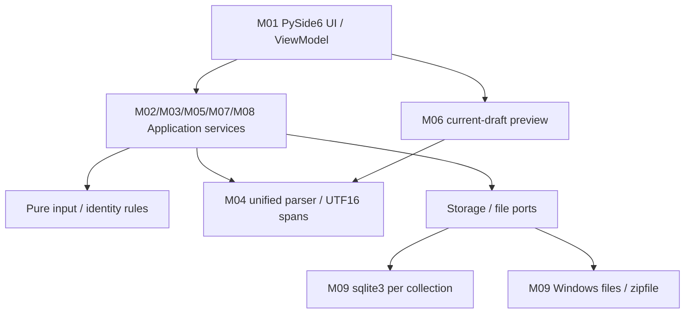

# 软件开发设计 · Python团队基线

- 版本：2026-10-18技术切换版，服务于团队开发；不自动重新提交课程平台。
- 本轮决定：用户明确选择Python，保留需求/分工、按依赖尽快推进。采用Python3.12+、PySide6 Qt Widgets、每集合独立SQLite。
- 需求依据：[第一关第二版需求](requirements.md)，FR01—FR11、FR16、NFR01—NFR06共18条。原需求未改写；v3提示/时间/扩充验收另列[待同步](development/pending-requirement-sync.md)。
- 历史来源：[C#设计第二版](archive/design-csharp-v2.md)保留原稿与历史SQL受限记录，其WPF/.NET签名不作为当前技术契约；本文件列出当前映射和业务不变量，具体Python类型在源码中可查。
- 实施状态：只有工程骨架、公共类型、上下文门禁和跨度转换、Qt启动壳及基础检查；业务服务、SQLite/解析适配尚未实现。V01—V16完整产品验证未执行。

## 1. 范围与设计选择

Windows11个人本地离线工具，学生用于课程记录/复习、知识工作者用于资料积累/关联；场景仍是分析假设，没有访谈或两周记录。

首版包含Markdown编辑/六类预览、标签、保存版全文检索、双向引用、单篇Markdown导出、手动保存、手动备份/独立恢复、单活动集合生命周期。FR03/NFR03/NFR04为中优先级也要验收，其余15条高优先级。

范围外FR12同步、FR13插件/主题、FR14移动端、FR15协作不实现；不增加自动保存、回收站、AI/OCR、集合合并/并行打开/跨集合引用、PDF/HTML/附件打包。

Python是本轮设计选择，不是第一关原定要求。Qt负责桌面UI，标准库sqlite3负责存储适配，Markdown解析库待C选择并通过契约审查后加入；旧AvalonEdit/Markdig不直接迁移。当前安装PySide6-Essentials/shiboken6各6.12.0，不加载WebEngine。

## 2. 架构与模块



文字依赖：Qt界面调用应用服务，应用服务依赖纯规则、解析和存储/文件端口；sqlite3/文件适配实现端口。Desktop作为组合入口接线，不在ViewModel直接SQL；纯规则/类型不能依赖Qt或数据库连接。

| 模块 | 负责人/包 | 职责与限制 |
|---|---|---|
| M01 | B / desktop | 入口、状态、确认、异步结果展示 |
| M02 | A / application.collection | 创建/打开/切换、发布/登记/激活及草稿保护；当前只有门禁组件 |
| M03 | B / application.editing | 草稿、保存/删除、核实/退出编排；C提供事务证据 |
| M04 | C / application.parsing | 统一解析、保护跨度和引用分类，无持久化副作用 |
| M05 | C / application.query | 只查询保存版，标签/正文/反向引用 |
| M06 | B（消费C解析） | 当前草稿预览，不隐式保存、不执行脚本/自动远程加载 |
| M07 | D / application.export | 保存单篇转换，原文跨度外字符不改 |
| M08 | D / application.backup_restore | 保存快照、清单、独立恢复/初始化编排 |
| M09 | C storage / D file_io | 连接事务/快照/回执与文件归档；A协调配置业务 |

## 3. 运行、线程与取消

- Qt主线程仅处理界面与受控最终激活，禁止执行阻塞数据库/归档或等待future.result。
- 设计使用一个后台asyncio事件循环接收异步服务调用，Qt通过工作线程结果信号回到主线程；此桥接尚待B/A实现，不假定Qt原生事件循环自动支持async def。
- 每集合写/一致快照/核实由串行存储队列调度到拥有该连接的工作线程；sqlite3连接不跨线程分享，不用check_same_thread=False代替串行设计。
- 文件任务消费冻结快照；解析/查询带集合代次、请求/编辑版本。主线程回调只应用匹配的结果。
- API的可选threading.Event表示协作取消意图。asyncio.CancelledError或Event置位不证明COMMIT回滚；持久化发出后先确认结果或进入UNCONFIRMED。不让外层future取消自动中断证据核实；服务收尾必须保留PendingSave并提供结果。
- 退出待在途数据库调用结束后，再检查当前上下文和全部buffer版本；明确未知退出要重新说明内存丢失风险。UI关闭前最终检查不能只在后台做一次。

这些是Python对应的运行设计，尚无完整线程桥/存储队列实现。ActiveContextGate只有带锁的最终内存切换/旧结果匹配，不证明文件已经发布或草稿已处理。

## 4. 数据模型与一致性

集合正式文件`knowledge.sqlite`，业务实体及SQL约束沿用原数据设计，不因换语言删减。原DDL可参考历史设计附录；真正接入sqlite3时须跑真实连接/事务检查，历史样例不能作产品验收。

| 实体 | 主要字段 | 约束 |
|---|---|---|
| CollectionMeta | collectionId/schemaVersion/collectionRevision/state | 单行；支持schemaVersion=1；正式READY；恢复新身份/集合版本1 |
| NoteKeys | noteId/state/liveNoteId/lastSavedName | LIVE/DELETED/MISSING_RESERVED；身份不可复用，删除保留名字 |
| Notes | noteId/keyState/name/nameKey/body/revision/lastCommitId | 与LIVE身份双向延迟外键，noteId/revision组合UNIQUE，名称键唯一 |
| NoteTags | noteId/tag | 复合主键，大小写区分，笔记删除级联 |
| RefOccurrence | sourceNoteId/sourceRevision/ordinal/targetCollectionId/targetNoteId/startUtf16/lengthUtf16/displayHint | 源复合外键，出站项随源删除；目标不强制LIVE；分类按保存事实计算 |
| CommitReceipt | commandId/operationId/collectionId/operationKind/noteId/beforeRevision/afterRevision/collectionRevision | SAVE/DELETE/RESTORE_INIT/RESTORE_NOTE_INIT不同字段形状，语义还需应用检查 |

每连接事务前启用并核对foreign_keys=ON。为保留明确BEGIN边界，拟使用sqlite3连接autocommit=True，写队列用显式SQL BEGIN/COMMIT/ROLLBACK，不依赖此模式下connection.commit()/rollback()的无操作行为；延迟约束失败后仍需明确结束事务。使用参数化SQL，版本递增前校验边界。

保存事务核对base_revision → 冻结输入/解析并校验 → 插入/更新身份与正文 → 替换标签/出站出现项 → 写SAVE回执并推进集合版本 → 提交。已有正文必须有LIVE身份，LIVE必须有正文；长度、数量、回执与正文内容匹配、跨度有效性由应用检查，不声称数据库保证全部语义。

删除先把身份置DELETED并保留名称，再删除正文；标签/出站级联，其他笔记入站保留用于失效展示。保存/删除失败确认未写或已回滚才称普通失败，不能核实则UNCONFIRMED状态保护。

恢复在恢复产物中生成新集合身份；原属该集合的有效/删除/缺失引用按规则转换，外来标记不转归属、不静默换绑。原始身份冲突/业务镜像矛盾拒绝，正常失效不当损坏。移除旧集合回执，仅在恢复产物新建集合级RESTORE_INIT及各篇RESTORE_NOTE_INIT；每篇lastCommitId指向自己的初始化回执，后续SAVE再更新。旧回执和初始化回执不能证明新集合SAVE。

## 5. 接口、类型与错误

[公共Python类型](../src/pmkb/contracts)为API01/02/08/11的准确字段和可空性入口；[契约说明](development/contracts.md)解释类型映射。Protocol声明不等于服务已实现。

| 编号/提供方 | 输入/输出要点 | 限制与错误 |
|---|---|---|
| API01/A | CREATE/OPEN、目标、Context、票据及逐buffer版本/选择；返回阶段/位置/ID、可空激活代次、登记三态及已保存buffer | 只准备不激活；旧票据STALE_CONTEXT；已发布未激活PARTIAL；未知优先UNCONFIRMED |
| API02/B | Create/Load/Apply/Save完整草稿；note_id/base_revision配对可空，冻结edit_version、command_id | 名称/标签/版本校验；ERROR/CANCELLED保存Value=None；成功COMMITTED版本非空；未知PENDING含PendingSave |
| API03/B+C | 笔记/预期版本/删除确认，核实原DELETE命令 | 未确认不删，未知核实DELETE而非SAVE |
| API04/C | 查询ID、关键词/标签、Context；结果/数量/集合版本 | 只保存版，空查询清旧结果，迟到丢弃 |
| API05/C | 已保存目标/标记/跨度/保存视图；引用/原因/反向列表 | 先集合归属，不能按名称回退 |
| API06/B+C | 当前正文/edit_version及目标保存视图；版本化预览 | 不写库，不执行脚本/远程资源 |
| API07/D | 选择笔记、合法.md目标、未保存选择；路径/保存修订 | CB01无保存版拒绝，已有目标拒绝，UNKNOWN阻止 |
| API08/D | Context、目标、未保存选择；源ID/位置/版本/UTC捕获时间/保存数量/发布状态 | NO_UNSAVED重新核对，发布未知不是SAVE未知，不交API11核实 |
| API09/D+C | 备份、空目标；新集合/位置/数量/来源识别 | 校验后新初始化，不改原集合/备份，不自动激活 |
| API10/C | 受控变更/预期版本/快照读取 | 内部服务专用，统一连接/事务/证据，不暴露连接给UI |
| API11/B+C | PendingSave/原SAVE命令/Context；COMMITTED/NOT_COMMITTED/UNRESOLVED或退出许可 | 只接受匹配SAVE，缺回执不等于失败；退出许可覆盖全部buffer最新版本 |

每次返回OperationResult：OK必须有Value且Error=None；ERROR有可读Error；PARTIAL有确定效果和未完成说明；UNCONFIRMED同时有未知详情Value/Error。CANCELLED不能伪填成功字段。configuration_updated为True/False/None，不能把None当False。版本/代次用int且拒绝bool；datetime必须aware/UTC。

沿用INVALID_NAME、DUPLICATE_NAME、INVALID_TAG、TAG_LIMIT、REVISION_CONFLICT、NO_SAVED_VERSION、TARGET_EXISTS、TARGET_NOT_EMPTY、INVALID_BACKUP、SCHEMA_UNSUPPORTED、STALE_CONTEXT、COMMIT_UNCONFIRMED，以及设计细化INVALID_ARGUMENT、NOTE_NOT_FOUND、IO_FAILURE、STATE_BLOCKED。错误含原因和下一步，不暴露正文/SQL堆栈。DELETED/MISSING/FOREIGN_COLLECTION是业务分类，不统一报损坏。

外部接口只有本地Windows文件/ZIP、sqlite3及解析库；没有后端账号/网络服务。API03—07/09/10精确Python对象由提供方与调用方先审查，未完成前不返回随意字典作为稳定契约。

## 6. 核心流程与异常

### 6.1 集合生命周期

Prepare只在空位置准备候选或只读验证已有集合，保留当前活动状态。Complete收集全部未保存buffer选择/版本；SAVE成功不回滚，DISCARD暂记；任意取消/失败/未知停止后续激活。CREATE确认发布后保留正式集合，必要登记确认成功且最终版本未变后才激活；只有实际激活才执行明确放弃。最终激活失败仍保原集合/草稿；已发布产物可稍后打开，不当临时文件清理。

取消与Complete串行协调，先登记意图再等待在途效果；只清本次自有未发布资源，不能删用户目标目录。源保存未知保留TEMP_VALIDATED/EXISTING_READY及PendingSave；目标发布未知用UNKNOWN；配置未知保留实际阶段且configuration_updated=None，不混成SAVE核实。

### 6.2 编辑、保存与退出

编辑仅改草稿 → 预览当前 → 手动保存冻结k → 事务确认。成功更新保存事实，仅将k标保存；后续编辑仍脏。普通失败保留草稿和旧事实。提交未知保留PendingSave/当前编辑，不重发写入，界面显示最后确认事实而非假装数据库当前已知。

API11找到本集合匹配SAVE/修订/lastCommitId/内容才COMMITTED；证据覆盖充分并确认原事务未提交才NOT_COMMITTED；不足仍UNRESOLVED。核实成功返回OK不必然表示SAVE成功。

| 会话状态 | 允许操作 | 退出结果 |
|---|---|---|
| 普通未保存 | 保存/放弃/取消 | 失败或取消保留，会话仍开 |
| 提交未知 | 保留内存编辑/重试核实/取消退出 | 不当普通保存失败 |
| 长期不可读 | 明确确认未知提交及放弃全部会话草稿风险 | 等原数据库调用结束后复核上下文/全部版本，关闭前UI再次检查；变化重新确认 |
| 结果后来已知 | 转普通关闭流程 | 不能继续用旧未知退出许可 |

### 6.3 引用、导出、备份、恢复

引用用双32位小写十六进制标记。目标改名仍通过身份定位，删除后账本保失效；代码内标记不建引用。保存前其他笔记反向列表不更新。

统一解析保护代码/外链/图片范围，导出只替换许可的内部引用原文跨度，不重新序列化整篇。Python用显式UTF16转换，生成文本转义Markdown特殊字符，不能意外形成有效内部链接。有效/失效输出仍为：

```text
内部引用：数据结构复习（仅供识别，导出后不支持应用内跳转）
失效内部引用：数据结构复习（目标已删除，无法跳转）
失效内部引用：未知目标（目标标识不存在或不可用，无法跳转）
失效内部引用：未知目标（引用来自其他集合，无法跳转）
```

外部链接/代码/图片路径不改，附件不打包；不保证所有第三方阅读器自动链接行为。默认note-名称.md按Windows禁用字符替换下划线/去末尾点空格，处理后为空用note.md；用户可重选合法.md名，已有文件拒绝覆盖。

备份冻结触发集合的保存快照，snapshot.sqlite为权威事实；manifest.json只记录格式/来源集合ID/来源位置/来源版本/实际快照捕获UTC时间/保存数量及校验摘要，恢复核对后使用；不让清单覆盖快照业务事实。本设计不强制固定三位毫秒或恢复时刻字段，那是v3待同步。来源位置仅识别，不访问原位置。

恢复校验条目、路径穿越、版本/计数/身份/引用派生一致性，在空目标建立新产物，初始化回执并发布；成功显示位置/数量和打开入口但不自动打开。失败不改原集合/备份；打开恢复集合仍走API01草稿保护。

## 7. 字符与输入细化

名称1—100码点/标签1—30、最多20个不同标签；先拒绝U+0000—001F/U+007F及单行U+2028/U+2029、无配对代理项，再裁剪允许空白。裁剪范围为U+0020/U+0085/U+00A0/U+1680/U+2000—200A/U+202F/U+205F/U+3000；不因Python str.strip默认集合而另改规则。

名称键只折叠英文ASCII A—Z，排除自身判重；不额外正规化或用casefold扩大判重。标签按原字符区分大小写，重复不占新名额。超限拒绝，保留原输入/数据，不截断。

Python输入解释是原设计Unicode细化的迁移，不标为题目原文。正文无10KB产品上限。解析/Qt光标各自的偏移必须在适配边界转换，startUtf16/lengthUtf16不能直接作为Python切片索引。

## 8. 界面、部署与非功能设计

主界面保留集合位置/入口、保存笔记列表、搜索/标签、编辑/预览、反向引用及保存/删除/输出/备份/恢复入口；学生侧重记录/复习，知识工作者侧重关联/专题查找，只是入口使用侧重，不加角色权限。

当前只显示开发状态窗口。后续每个错误须可辨操作/原因/下一步；普通失败与待核实分开，失效原因不只靠颜色。此轮不引入v3整套精确字典。预览六类Markdown，禁止脚本和远程自动资源。

计划发行Windows文件夹包，包含Python运行依赖、Qt/插件、程序和许可信息；具体打包工具待选并实际验证，不宣称已有成品。程序目录、用户集合knowledge.sqlite、用户LOCALAPPDATA下必要身份/位置配置分开；不把配置当保存事实，不记录正文。无账号、云目录或自动下载/迁移。未知schemaVersion只读检查后拒绝，不改原集合/备份/草稿。

NFR01离线：核心依赖全本地；显式网页访问另计。NFR02完整性：事务/回执/非覆盖/发布保护，故障注入后核对。NFR03性能：1000篇UTF8正文≤10240字节，固定30查询至少29次≤2秒且完整正确，记录实际设备/Windows11、预热/负载/顺序/计时，全部30次计入。NFR04可辨提示：实际操作脚本判定。NFR05隐私：不主动上传笔记/正文遥测/远程资源。NFR06兼容：真实Windows11字符/路径/核心流程后续测量，CI的Windows runner不冒充用户Windows11验收。

## 9. 设计权衡、维护和验证

Python降低团队语言转换门槛，代价是运行时输入校验、类型检查和发行依赖需明确；PySide6适合桌面界面，Qt与asyncio桥需设计，不能把async def直接连按钮就算完整异步。SQLite保留关联事务一致性，代价是不能外部直接编辑Markdown文件，需要FR09导出。独立Markdown文件方案需跨文件事务/索引恢复，当前不采用。

领域/契约不依赖Qt/具体连接；解析器返回本系统树/跨度，调用方不依赖第三方AST；基础设施实现端口。后续通过导入边界审查和固定样例确认这些约束，不以可替换为由新增插件/同步/移动端。

| 需求/优先级 | 对应设计/负责人 | 拟验证 |
|---|---|---|
| FR01/高 | 输入/保存/删除，B+C | V01/02/06 |
| FR02/高 | 草稿/原文保存，B | V02 |
| FR03/中 | 当前预览，B+C | V03 |
| FR04/高 | 标签及保存版筛选，B+C | V01/02/04 |
| FR05/高 | 保存版查询，C | V04/10 |
| FR06/高 | 双身份引用/归属，C | V05 |
| FR07/高 | 保存版反向引用，C | V02/05 |
| FR08/高 | 身份/删除账本，C | V05/06/09 |
| FR09/高 | 单篇普通文本导出/CB01，D | V07 |
| FR10/高 | 手动保存/关闭/CB02，B+C+A | V02/13/15 |
| FR11/高 | 快照/独立恢复/CB01，D+C | V08/09/16 |
| FR16/高 | 集合协调，A | V09/15 |
| NFR01/高 | 本地运行与发行，四人 | V11 |
| NFR02/高 | 事务/回执/发布/输入，四人 | V02/06/08/09/13/14/15/16 |
| NFR03/中 | 查询规模/计时，C+A | V10 |
| NFR04/中 | 状态/反馈，B | V12/13/15 |
| NFR05/高 | 无账号/自动外传，四人 | V11 |
| NFR06/高 | Unicode/Windows/路径，四人 | V01/07/12/14 |

V01名称标签；V02保存版本；V03预览；V04查询；V05引用；V06删除；V07导出；V08备份；V09恢复；V10性能；V11离线隐私；V12界面Windows；V13未知提交；V14约束/模块契约；V15发布激活；V16清单/回执。**完整产品验证全部未执行。** 当前基础检查只有小组件及离屏启动，历史SQLite16项记录仅SQL设计受限证据。

## 10. 来源与变更

需求仍为第一关第二版。CB01是后续无保存版本边界澄清，影响FR09/11、V07/08；CB02是极端异常设计，影响FR10及跨模块操作、V13/15/16；都不倒写成第一关原文。

本轮用户确认语言切换，改变工程/界面/类型/取消/部署实现方式，不改变18条需求及15高/3中优先级；旧.NETTrim/Task/CancellationToken等按本文映射，不静默使用Python不同默认语义。第一关v3仍待整体同步。尚未选定的解析库、发行工具和未完成接口由对应工作包通过PR对齐，不能被写成已实现。

技术说明参考：[Qt for Python](https://doc.qt.io/qtforpython-6/gettingstarted.html)、[sqlite3事务控制](https://docs.python.org/3.12/library/sqlite3.html)、[asyncio取消](https://docs.python.org/3.12/library/asyncio-task.html#task-cancellation)。上述资料支持技术行为，人员分工及业务决定来自项目讨论，不标成老师原题。
